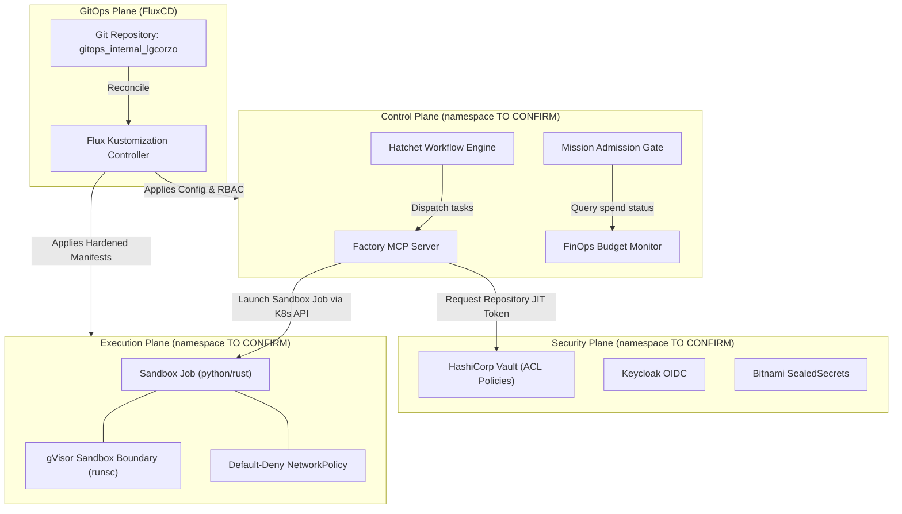
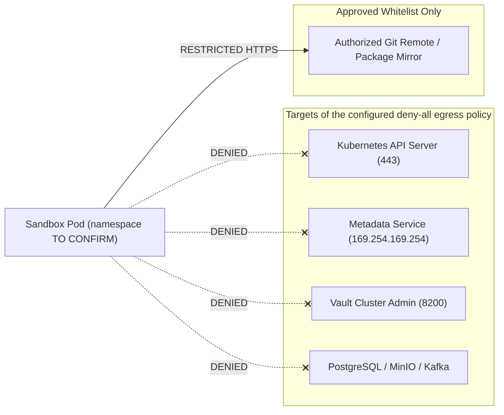

> **Superseded 2026-11-11:** This historical architecture document describes a target topology, not a live deployment inventory. `deploy/` defines no `Namespace` objects, and the repository does not establish active CNI enforcement or live workload placement. See [the documentation fact register](../audit/DOC_FACT_REGISTER.md); deployed namespace inventory and enforcement are **TO CONFIRM**.

# Deployment Architecture & Plane Boundaries

**Specification**: `010-integrated-k8s-gitops-audit`  
**Date**: `2026-11-02`

---

## 1. Multi-Plane Architecture Overview

Dark Gravity separates responsibilities into four distinct planes:
1. **Control Plane**: Workflow dispatchers, Hatchet scheduler, FinOps monitors, and the MCP server.
2. **Security & Identity Plane**: HashiCorp Vault, Keycloak, and Ed25519 NHI credential issuers.
3. **Execution Plane (Isolated Sandboxes)**: Ephemeral Kubernetes Jobs configured for gVisor (`runsc`). Their deployed namespace is **TO CONFIRM**.
4. **GitOps & Reconciliation Plane**: FluxCD controllers synchronizing manifests from `gitops_internal_lgcorzo`.

---

## 2. Mermaid Plane Architecture Diagram

---

## 3. Network Isolation Policy Architecture

