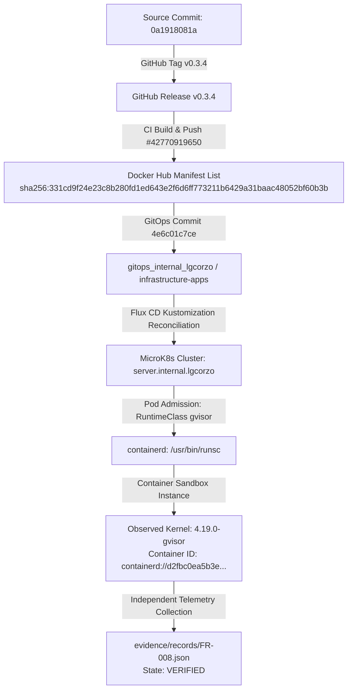

# Deployment Provenance & End-to-End Traceability Matrix

**Programme:** DG-RVP-015  
**Baseline Release:** `v0.3.4`  
**Factory Image:** `docker.io/lgcorzo/dark-gravity-factory`  

---

## 1. Full Traceability Chain

The following diagram and table illustrate the cryptographically binding chain from developer commit to live container execution under gVisor.

---

## 2. Cryptographic Alignment Table

| Stage | Entity | Hash / Identifier | Verification Method | Status |
| :--- | :--- | :--- | :--- | :--- |
| **Source Code** | Git Tree | `0a1918081ac6307051aee73ffadddb372e032db8` | `git rev-parse HEAD` | Confirmed |
| **Release Tag** | GitHub Release | `v0.3.4` | GitHub API | Published |
| **OCI Image** | Docker Image Digest | `sha256:331cd9f24e23c8b280fd1ed643e2f6d6ff773211b6429a31baac48052bf60b3b` | Docker Registry Manifest API | Verified |
| **GitOps Spec** | Git Repository | `4e6c01c7ce30483a4dfc8dd534c3adcb8b5c4fd7` | Flux CD `kustomization/infrastructure-apps` | Reconciled |
| **Kubernetes Pod** | Pod UID | `81d2f4fc-c048-41fc-abde-eca6f93fa4da` | `microk8s kubectl get pods -o json` | Observed |
| **Runtime Container** | Container Image ID | `docker.io/lgcorzo/dark-gravity-factory@sha256:331cd9f24e23c8b280fd1ed643e2f6d6ff773211b6429a31baac48052bf60b3b` | Pod `status.containerStatuses[0].imageID` | **Identical** |
| **Sandbox Runtime** | Kernel Release | `4.19.0-gvisor` | Pod Container Exec (`uname -r`) | Corroborated |
| **Host Kernel** | Host Operating System | `6.17.0-14-generic` | Node OS Kernel (`uname -r`) | Divergent |
| **Evidence Record** | Evidence Artifact Hash | `fa9ab2df1c28e18100cab37a5a19de1b60357515214173017039d53a918593d2` | `sha256sum evidence/runs/FR-008.log` | Validated |
