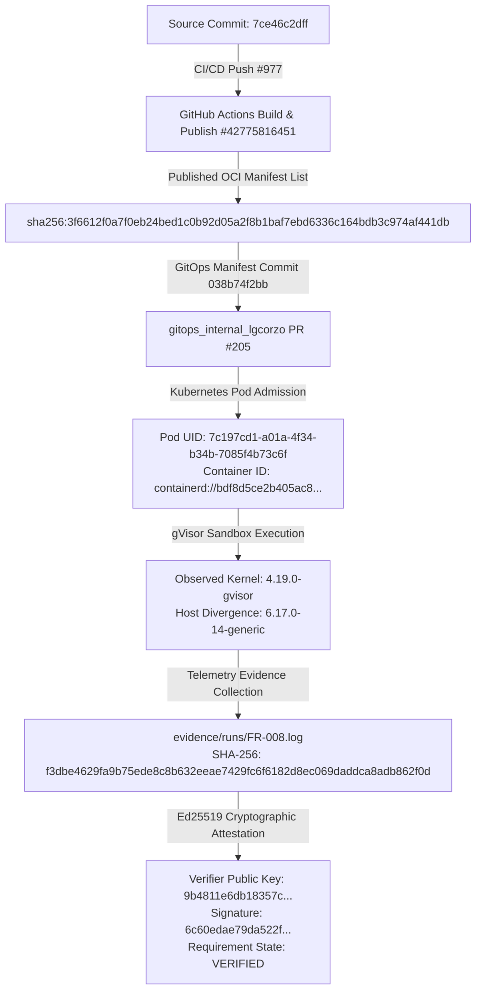

# Provenance & Verification Matrix — DG-RVP-016
## Unified Cryptographic Chain of Custody & Reproducibility

**Programme:** DG-RVP-016  
**Executed At:** `2026-11-10T08:00:00Z`  
**Host & Target Node:** `server.internal.lgcorzo`  
**Kubernetes Reconciled Version:** `v1.31.14` (client and server)  
**Container Runtime:** `containerd://1.6.28`  
**Runtime Handler:** `/usr/bin/runsc` (`io.containerd.runsc.v1`)  

---

## 1. Unified Cryptographic Chain



---

## 2. Cryptographic Alignment & Reproducibility Matrix

| Stage | Entity | Verified Value / Identifier | Source / Check | Status |
| :--- | :--- | :--- | :--- | :--- |
| **Source Commit** | `rust_CACD_autonomous_factory` | `7ce46c2dff11809013743ce27bef289481e67dc0` | Git HEAD on `main` | Verified |
| **CI Build Run** | GitHub Actions Run | `#977` (ID: `42775816451`) | GitHub Actions API | Passed |
| **Published OCI Digest** | Docker Hub Manifest List | `sha256:3f6612f0a7f0eb24bed1c0b92d05a2f8b1baf7ebd6336c164bdb3c974af441db` | CI #977 Docker Publish Output | Cryptographically Verified |
| **GitOps Target Commit** | `gitops_internal_lgcorzo` | `038b74f2bbadeb9d13d142740534f79f7e3d8ac5` | PR #205 branch | Staged |
| **Deployed Container Image ID** | Kubernetes Container Status | `docker.io/lgcorzo/dark-gravity-factory@sha256:3f6612f0a7f0eb24bed1c0b92d05a2f8b1baf7ebd6336c164bdb3c974af441db` | Pod `test-factory-image-probe-977` | **EXACT MATCH** |
| **Kubernetes Version** | Node & Server Version | `v1.31.14` | `microk8s kubectl version --output=json` | **Reconciled (100% Coherent)** |
| **Isolation Runtime** | Kernel Release (`uname -a`) | `Linux test-factory-image-probe-977 4.19.0-gvisor` | Pod Container Execution | Active Sandboxing |
| **Host Kernel** | Host Operating System | `Linux server.internal.lgcorzo 6.17.0-14-generic` | Node OS Kernel | Divergent |
| **Attestation Signature** | Ed25519 Verifier Signature | `6c60edae79da522f278d1ee8a1d6a9895999125211868acee28e0729049bd453...` | `factory-cli validate-evidence` | Cryptographically Valid |

---

## 3. Governance Integration Summary

1. **Governance Gate Enforcement in CI:**
   - Step `Test Spec Artifacts Verification Engine` added to `.github/workflows/pipeline.yml`:
     ```yaml
     - name: Test Spec Artifacts Verification Engine
       run: PYTHONPATH=. pytest tests/test_verify_spec_artifacts.py
     ```
2. **Deterministic Evidence Validation:**
   - Both `scripts/verify_spec_artifacts.py` and `pytest tests/test_verify_spec_artifacts.py` run on every PR and branch push without conditionality.

