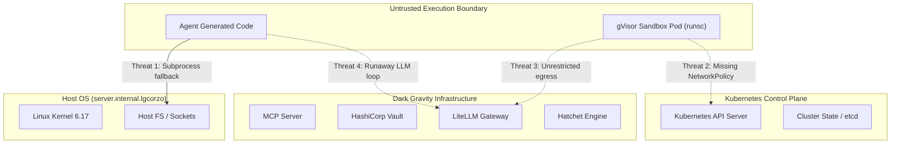

> **Superseded 2026-11-11:** This historical threat model includes cluster and enforcement assumptions. The checked-in configuration contains Kubernetes and Cilium network policy objects, but does not identify the installed CNI or establish active enforcement. See [the documentation fact register](DOC_FACT_REGISTER.md); installed CNI is **TO CONFIRM**.

# Threat Model: Dark Gravity Execution & Control Plane

**Specification**: `010-integrated-k8s-gitops-audit`  
**Date**: `2026-11-02`

---

## 1. Assets & Critical Resources
1. **Host Operating System & Kernel**: Filesystems, processes, Unix domain sockets, and kernel memory of the cluster node (`server.internal.lgcorzo`).
2. **Kubernetes Control Plane API**: Kubernetes API server credentials, etcd state, ServiceAccount tokens.
3. **Internal Secrets & Credentials**: Vault role tokens, repository SSH/deploy keys, Bitnami SealedSecrets private keys.
4. **Cloud & Infrastructure Endpoints**: Metadata service (`169.254.169.254`), internal database connections (PostgreSQL, MinIO, Kafka).
5. **Financial & Computational Quotas**: LLM API credits, LiteLLM gateway budgets, GPU compute resources.

---

## 2. Threat Actors & Personas
- **Malicious LLM Code Generator (Adversarial Untrusted Workload)**: An automated code synthesis agent that outputs obfuscated shell scripts, container escape exploits, or crypto-miners.
- **Compromised Ingress / Webhook Caller**: Attacker attempting to trigger missions or poison context via unauthenticated webhooks or SSE endpoints.
- **Runaway Agent (Denial of Service & Budget Exhaustion)**: An agent trapped in a recursive self-improvement loop consuming unbounded API tokens.

---

## 3. Trust Boundaries & Attack Paths

---

## 4. Mitigations & Enforced Controls

| Threat ID | Description | Primary Mitigation | Enforcing Mechanism |
|---|---|---|---|
| **THREAT-1** | Host filesystem access via `SubprocessDriver` | Fail-closed production mode; deny host process spawn | `crates/factory-mcp-server/src/sandbox.rs` |
| **THREAT-2** | Container breakout to host kernel via standard `runc` | Mandatory `RuntimeClass: gvisor` | MicroK8s `runsc` virtualized kernel |
| **THREAT-3** | Unauthorized lateral movement to Kube API or Vault | Kubernetes and Cilium network policy objects are checked in; active enforcement is **TO CONFIRM** | Installed CNI is **TO CONFIRM** |
| **THREAT-4** | Ingestion of fabricated test results | Require sandboxed test execution; typed `TestExecutionReport` | `crates/factory-mcp-server/src/tools/run_tests.rs` |
| **THREAT-5** | Runaway LLM spend exceeding budget | FinOps budget latch integrated into mission admission | `factory-application/src/agents/finops.rs` |
| **THREAT-6** | Sandbox pod resource exhaustion | Strict CPU (250m), memory (30Mi), and TTL (300s) cleanup | Kubernetes Job Spec |
