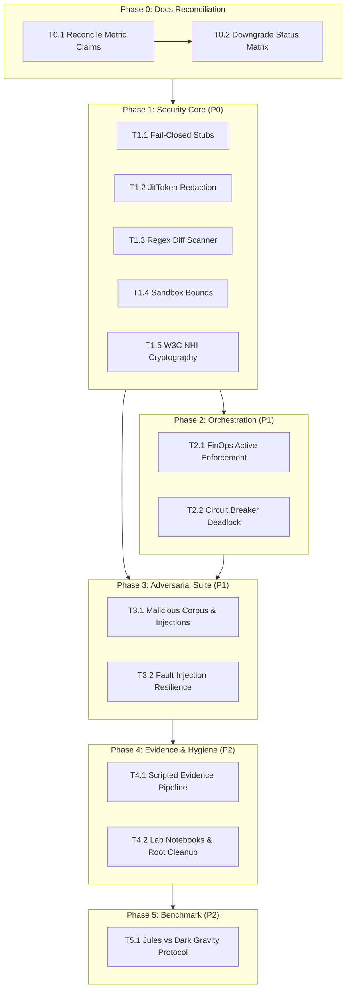

# Dark Gravity Hardening & Quality Implementation Plan

> **For agentic workers:** REQUIRED SUB-SKILL: Use `superpowers:subagent-driven-development` (recommended) or `superpowers:executing-plans` to implement this plan task-by-task. Steps use checkbox (`- [ ]`) syntax for tracking.

**Goal:** Eliminate the discrepancy between documented claims and codebase reality, harden core security and orchestration components, establish an adversarial testing suite, and generate reproducible, CI-backed evidence to elevate the overall quality and trustworthiness of the Dark Gravity Autonomous Factory.

**Architecture:** 
1. **Docs & Truth Reconciliation**: Audit manifests and codebase to align README, wiki, and lab notebooks with real configuration values and downgrade unverifiable claims to "Designed".
2. **Security & Cryptography Hardening**: Eliminate fail-open stubs, sanitize secrets in `JitToken` with zeroization/redaction, refactor the diff scanner to an AST/token-aware heuristic tripwire scanning added lines only, enforce RFC 8785 (JCS) canonicalization and W3C camelCase compliance with replay protection in `nhi.rs`, and validate sandbox memory/CPU bounds.
3. **Orchestration & FinOps Guardrails**: Implement active hardstop enforcement (Kafka event dispatch + scheduler halt latch), client timeouts, backoff error handling, and diff deadlock oscillation detection in `CircuitBreakerGuard`.
4. **Adversarial & Reproducibility Suite**: Build a dedicated adversarial corpus (`tests/adversarial/`), automated evidence generation pipeline (`make evidence`), and structured benchmark protocol.

**Tech Stack:** Rust 2024, Tokio, Serde/Serde-JSON, `serde_jcs`, Ed25519-dalek, `secrecy`, Wiremock/Httpmock, Reqwest 0.12, RdKafka, Criterion.

---

## Global Constraints

- **Workspace Path**: `/mnt/F024B17C24B145FE/Repos/rust_CACD_autonomous_factory`
- **Rust Edition**: 2024 (Workspace crates: `factory-core`, `factory-application`, `factory-infrastructure`, `factory-cli`, `factory-mcp-server`)
- **HITL Enforcement**: Under no circumstances may an agent automatically merge a PR into `main` or default branches. Manual human review and approval is required (`AGENTS.md`).
- **PR Hygiene**: One task = one small PR. Branch naming convention: `hardening/<task-id>`.
- **Quality Gates on Every PR**:
  ```bash
  cargo fmt --check
  cargo clippy --workspace --all-targets -- -D warnings
  cargo test --workspace
  cargo audit
  ```
- **Code Standards**: No new `unwrap()`, `expect()`, or `unsafe` in non-test code. Security stubs must fail closed (return error, never default to safe).

---

## Phase 0: Reconcile Documentation with Reality (P0)

### Task 0.1: Resolve Contradictory Metric and Architecture Claims

**Files:**
- Modify: `README.md`
- Modify: `wiki/index.md`
- Modify: `docs/superpowers/specs/`
- Test: Documentation consistency search script

**Interfaces:**
- Produces: Single source of truth across documentation for sandbox memory limits, network policy engines, and virtualization runtimes.

- [x] **Step 1: Inspect actual manifests to determine real configuration limits**
Run grep and inspect:
```bash
grep -rn "SandboxConstraint" crates/
grep -rn "30" crates/factory-core/src/security.rs
grep -rn -E "Cilium|Calico|Firecracker|gVisor" k8s/ helm/ 2>/dev/null || true
```

- [x] **Step 2: Update README and Wiki to reconcile single truth**
Standardize on the verified operational model:
- Clarify distinction between micro-sandbox constraint (30 MiB in `SandboxConstraint` unit tests) and container execution limits (512 MiB worker profile in Kubernetes).
- Document network policy as Calico default-deny (or Cilium if eBPF manifests exist, unified to one truth).
- Rename memory configuration fields in Rust code and docs from `max_memory_mb` to `max_memory_mib` if MiB is intended.

- [x] **Step 3: Verify no conflicting claims remain**
Run:
```bash
grep -rn "30 MiB" README.md wiki/
grep -rn "Cilium" README.md wiki/
```
Expected: All references consistently differentiate the micro-sandbox profile from worker deployment configurations without contradiction.

- [x] **Step 4: Commit and branch PR**
```bash
git checkout -b hardening/T0.1-docs-reconciliation
git add README.md wiki/
git commit -m "docs: reconcile sandbox RAM and network engine claims with manifest reality"
```

---

### Task 0.2: Downgrade Unsupported Claims in Status Matrix

**Files:**
- Modify: `README.md`
- Modify: `evidence/`

**Interfaces:**
- Produces: Honest capability status matrix (Downgrading unverified features from "Verified" to "Designed" or "Implemented").

- [x] **Step 1: Audit status matrix against existing evidence directory**
Inspect artifacts in `evidence/`:
```bash
ls -la evidence/
```
Verify which rows in the README feature matrix lack reproducible automated runs:
- "W3C compliant Non-Human Identity" -> mark `Implemented` (pending RFC 8785 JCS canonicalization).
- "SAST scanner" -> mark `Implemented (Heuristic Tripwire)`.
- "FinOps hard stop / 429" -> mark `Designed` (currently log-only in code).
- "Forensic RAM sanitization" -> mark `Implemented (Zeroize on Drop)`.
- "SOC 2 / EU AI Act" compliance claims -> refine to "Designed for compliance readiness".

- [x] **Step 2: Update README.md status table**
Update each status badge/label and link only existing, CI-produced evidence files.

- [x] **Step 3: Commit and branch PR**
```bash
git checkout -b hardening/T0.2-downgrade-unverified-claims
git add README.md
git commit -m "docs: adjust capability status matrix to reflect verified automated evidence"
```

---

## Phase 1: Security-Critical Fixes (P0)

### Task 1.1: SecurityValidator Stubs Fail Closed

**Files:**
- Modify: `crates/factory-core/src/security.rs:41-47,145-152`
- Modify: `crates/factory-infrastructure/src/security_validator.rs:98-120`
- Test: `crates/factory-core/tests/security_tests.rs`

**Interfaces:**
- Consumes: `SecurityValidator::audit_content(&self, content: &str) -> Result<AuditResult>`
- Produces: Fail-closed `Err(FactoryError::Security(...))` when auditor is unconfigured, preventing bypass.

- [x] **Step 1: Write the failing test**
In `crates/factory-core/tests/security_tests.rs`:
```rust
#[tokio::test]
async fn test_default_security_validator_fails_closed() {
    let raw_key = [1u8; 32];
    let verifying_key = ed25519_dalek::VerifyingKey::from_bytes(&raw_key).unwrap();
    let validator = factory_core::security::Ed25519SecurityValidator { public_key: verifying_key };
    
    let result = validator.audit_content("fn safe_function() {}").await;
    assert!(result.is_err(), "Default unconfigured auditor must fail closed with error");
}
```

- [x] **Step 2: Run test to verify it fails**
Run: `cargo test -p factory-core test_default_security_validator_fails_closed`
Expected: FAIL (currently returns `Ok(AuditResult { is_safe: true, ... })`).

- [x] **Step 3: Implement fail-closed semantics**
In `crates/factory-core/src/security.rs`:
```rust
async fn audit_content(&self, _content: &str) -> Result<AuditResult> {
    Err(crate::error::FactoryError::Security(
        "Content auditor is unconfigured or not implemented; failing closed".to_string()
    ))
}
```
In `crates/factory-infrastructure/src/security_validator.rs`:
Parse MCP `security_review` response properly instead of ignoring `_res`, and return error if unconfigured.

- [x] **Step 4: Run test to verify it passes**
Run: `cargo test -p factory-core test_default_security_validator_fails_closed`
Expected: PASS

- [x] **Step 5: Commit and branch PR**
```bash
git checkout -b hardening/T1.1-fail-closed-stubs
git add crates/factory-core/ crates/factory-infrastructure/
git commit -m "security: ensure audit_content stubs fail closed on unconfigured validators"
```

---

### Task 1.2: JitToken Secret Redaction and Safe Memory Handling

**Files:**
- Modify: `crates/factory-core/src/security.rs:154-188`
- Modify: `crates/factory-core/Cargo.toml`
- Test: `crates/factory-core/tests/security_tests.rs`

**Interfaces:**
- Produces: Redacted `Debug`, eliminated naked `Serialize`, protected secret access via `expose_token()`, and safe drop zeroization test.

- [x] **Step 1: Write the failing test**
In `crates/factory-core/tests/security_tests.rs`:
```rust
#[test]
fn test_jit_token_debug_redacts_secret_and_no_unsafe_leak() {
    let secret = "vault-token-super-secret-12345";
    let token = factory_core::security::JitToken::new(secret.to_string());
    
    let debug_output = format!("{:?}", token);
    assert!(!debug_output.contains(secret), "Debug representation must redact secret");
    assert!(debug_output.contains("[REDACTED]"));
    assert_eq!(token.expose_token(), secret);
}
```

- [x] **Step 2: Run test to verify it fails**
Run: `cargo test -p factory-core test_jit_token_debug_redacts_secret_and_no_unsafe_leak`
Expected: FAIL (`token.token` is currently a public plaintext string printed in `Debug`).

- [x] **Step 3: Refactor JitToken**
In `crates/factory-core/src/security.rs`:
- Make the secret field private.
- Implement manual `fmt::Debug` printing `JitToken { token: "[REDACTED]" }`.
- Provide `pub fn expose_token(&self) -> &str`.
- Retain `Zeroize` and `ZeroizeOnDrop`.
- Replace the `unsafe` memory inspection test `test_zeroize` with a safe drop validation test.

- [x] **Step 4: Run test to verify it passes**
Run: `cargo test -p factory-core test_jit_token_debug_redacts_secret_and_no_unsafe_leak`
Expected: PASS

- [x] **Step 5: Commit and branch PR**
```bash
git checkout -b hardening/T1.2-jittoken-redaction
git add crates/factory-core/
git commit -m "security: redact JitToken in Debug and eliminate unsafe test blocks"
```

---

### Task 1.3: Heuristic Diff Scanner Rewrite (`SastScanResult::inspect_diff`)

**Files:**
- Modify: `crates/factory-core/src/security.rs:54-122`
- Test: `crates/factory-core/tests/sast_scan_tests.rs`

**Interfaces:**
- Consumes: Unified `ScanPolicy` threshold configuration.
- Produces: `pub fn inspect_diff_with(diff: &str, policy: &ScanPolicy) -> SastScanResult`.
- Guarantees:
  - Scans only added lines (`+` prefix, ignoring `+++` file header).
  - Uses word-boundary regexes instead of substring checks (`\b(eval|exec|system)\s*\(`).
  - Handles removed secrets gracefully without triggering false positives.

- [x] **Step 1: Write comprehensive table-driven failing tests**
Create `crates/factory-core/tests/sast_scan_tests.rs`:
```rust
use factory_core::security::SastScanResult;

#[test]
fn test_sast_diff_scanner_added_lines_and_word_boundaries() {
    // 1. False positive resistance: "retrieval(" and "filesystem(" should NOT flag
    let safe_diff = "@@ -1,3 +1,3 @@\n+ let data = retrieval(param);\n+ let fs = filesystem(path);";
    let res = SastScanResult::inspect_diff(safe_diff);
    assert!(res.is_safe, "Safe function names must not trigger false positive RCE findings");

    // 2. Secret removal should NOT flag
    let secret_removal_diff = "@@ -10,3 +10,2 @@\n- password = \"supersecret123\"\n+ password = get_env_var()";
    let res2 = SastScanResult::inspect_diff(secret_removal_diff);
    assert!(!res2.critical_vulnerabilities_detected, "Removing a secret must not be flagged as a critical leak");

    // 3. True positive: actual command execution
    let rce_diff = "@@ -1,2 +1,3 @@\n+ let _ = std::process::Command::new(\"bash\").arg(\"-c\").spawn();";
    let res3 = SastScanResult::inspect_diff(rce_diff);
    assert!(!res3.is_safe);
    assert!(res3.critical_vulnerabilities_detected);
}
```

- [x] **Step 2: Run test to verify it fails**
Run: `cargo test -p factory-core test_sast_diff_scanner_added_lines_and_word_boundaries`
Expected: FAIL (current implementation flags `retrieval(` because it contains `eval(`).

- [x] **Step 3: Implement line filter and regex tripwire**
In `crates/factory-core/src/security.rs`:
- Filter diff lines: `diff.lines().filter(|line| line.starts_with('+') && !line.starts_with("+++"))`.
- Implement `LazyLock<Regex>` for RCE patterns (`\b(eval|exec|system)\s*\(`), secrets, and SQL injections.
- Add tripwires for: `Command::new("bash"|"sh"|"cmd")`, `reqwest::`, `TcpStream`, `remove_dir_all`.
- Parameterize threshold via `ScanPolicy` (defaulting to 8.0).

- [x] **Step 4: Run tests to verify all pass**
Run: `cargo test -p factory-core --test sast_scan_tests`
Expected: PASS

- [x] **Step 5: Commit and branch PR**
```bash
git checkout -b hardening/T1.3-sast-diff-scanner-regex
git add crates/factory-core/
git commit -m "security: rewrite diff scanner to inspect added lines with regex boundaries"
```

---

### Task 1.4: Strict Sandbox Constraint Bounds Validation

**Files:**
- Modify: `crates/factory-core/src/security.rs:6-39`
- Test: `crates/factory-core/src/security.rs`

**Interfaces:**
- Produces: `SandboxConstraint::validate_bounds(&self) -> bool` with constants, zero/negative guards, and egress enforcement.

- [x] **Step 1: Write the failing test**
In `crates/factory-core/src/security.rs` tests module:
```rust
#[test]
fn test_sandbox_constraint_strict_bounds() {
    let mut constraint = SandboxConstraint::gvisor_default();
    assert!(constraint.validate_bounds());

    // Egress must be forbidden
    constraint.network_egress_allowed = true;
    assert!(!constraint.validate_bounds(), "Egress must fail bounds check");

    // Zero or negative limits must fail
    constraint.network_egress_allowed = false;
    constraint.max_memory_mb = 0;
    assert!(!constraint.validate_bounds(), "0 MB must fail bounds check");
}
```

- [x] **Step 2: Run test to verify it fails**
Run: `cargo test -p factory-core test_sandbox_constraint_strict_bounds`
Expected: FAIL (currently does not check `network_egress_allowed == false` or `max_memory_mb > 0`).

- [x] **Step 3: Enforce strict constraints**
In `crates/factory-core/src/security.rs`:
```rust
pub const MAX_SANDBOX_MEMORY_MIB: u32 = 30;
pub const MAX_SANDBOX_CPU_CORES: f32 = 0.25;

pub fn validate_bounds(&self) -> bool {
    !self.network_egress_allowed
        && self.max_memory_mb > 0
        && self.max_memory_mb <= MAX_SANDBOX_MEMORY_MIB
        && self.max_cpu_cores > 0.0
        && self.max_cpu_cores <= MAX_SANDBOX_CPU_CORES
}
```

- [x] **Step 4: Run test to verify it passes**
Run: `cargo test -p factory-core test_sandbox_constraint_strict_bounds`
Expected: PASS

- [x] **Step 5: Commit and branch PR**
```bash
git checkout -b hardening/T1.4-sandbox-bounds-validation
git add crates/factory-core/
git commit -m "security: enforce strict bounds, egress denial, and non-zero sandbox limits"
```

---

### Task 1.5: Non-Human Identity (NHI) W3C & Cryptographic Standards Compliance

**Files:**
- Modify: `crates/factory-core/src/security/nhi.rs`
- Modify: `crates/factory-core/Cargo.toml` (add `serde_jcs` for RFC 8785 canonicalization)
- Test: `crates/factory-core/tests/nhi_cryptographic_tests.rs`

**Interfaces:**
- Produces:
  - W3C `camelCase` serialization for `VerifiableCredential` and `CryptographicProof`.
  - RFC 8785 JCS canonicalization over payload AND proof options.
  - Expiry and replay verification (`verify_at(now: DateTime<Utc>) -> Result<VerificationOutcome>`).
  - Atomic batch signing.

- [x] **Step 1: Write the failing tests**
Create `crates/factory-core/tests/nhi_cryptographic_tests.rs`:
```rust
#[test]
fn test_nhi_w3c_camel_case_and_expiry_rejection() {
    // 1. Serialization must use camelCase
    let vc = create_test_credential();
    let json = serde_json::to_string(&vc).unwrap();
    assert!(json.contains("\"issuanceDate\":"));
    assert!(json.contains("\"credentialSubject\":"));
    assert!(!json.contains("\"issuance_date\":"));

    // 2. Expired credential verification must fail
    // assert!(vc.verify_at(expired_time).is_err());
}
```

- [x] **Step 2: Run test to verify it fails**
Run: `cargo test -p factory-core --test nhi_cryptographic_tests`
Expected: FAIL

- [x] **Step 3: Implement W3C serde attributes, JCS canonicalization, and strict verification**
In `crates/factory-core/src/security/nhi.rs`:
- Add `#[serde(rename_all = "camelCase")]` to `VerifiableCredential` and `CryptographicProof`.
- Add `expiration_date: Option<DateTime<Utc>>` and `nonce: Option<String>`.
- Use `serde_jcs` to canonicalize both payload and proof options into signing input.
- Replace unstructured booleans with `enum VerificationOutcome { Valid, Expired, BadSignature, Malformed }`.
- Make batch signing atomic: buffer signatures and assign only on full success.

- [x] **Step 4: Run test to verify it passes**
Run: `cargo test -p factory-core --test nhi_cryptographic_tests`
Expected: PASS

- [x] **Step 5: Commit and branch PR**
```bash
git checkout -b hardening/T1.5-nhi-w3c-cryptography
git add crates/factory-core/
git commit -m "crypto: enforce W3C camelCase, RFC 8785 JCS canonicalization, and replay expiry in NHI"
```

---

## Phase 2: Orchestration Guardrails (P1)

### Task 2.1: FinOps Enforcement, Timeouts, and Anomaly Latch

**Files:**
- Modify: `crates/factory-application/src/agents/finops.rs`
- Test: `crates/factory-application/tests/finops_agent_tests.rs`

**Interfaces:**
- Produces:
  - Enforced client timeouts (`Duration::from_secs(10)` request, `Duration::from_secs(3)` connect).
  - HardStop action: dispatches Kafka budget event and flips atomic/watch halt latch.
  - Normalized velocity calculation (`$/min` against elapsed time).
  - First-cycle anomaly suppression (`previous_spend: Option<f64>`).
  - Explicit configuration error when required env vars are missing or unparseable.

- [x] **Step 1: Write failing mock test for FinOps enforcement**
Create `crates/factory-application/tests/finops_agent_tests.rs` with `wiremock`:
```rust
#[tokio::test]
async fn test_finops_hardstop_halts_and_handles_http_errors() {
    // Test that 500 error triggers backoff and consecutive_failures increment
    // Test that spend >= 90% budget dispatches halt event and sets halted latch
}
```

- [x] **Step 2: Run test to verify it fails**
Run: `cargo test -p factory-application --test finops_agent_tests`
Expected: FAIL

- [x] **Step 3: Implement robust FinOps client and enforcement logic**
In `crates/factory-application/src/agents/finops.rs`:
- Configure `ClientBuilder::new().timeout(Duration::from_secs(10)).connect_timeout(Duration::from_secs(3))`.
- Track `halted: Arc<AtomicBool>` latch.
- On `BudgetEvaluation::HardStop`: invoke `dispatch_budget_exceeded_event` and set `halted` to `true`.
- Handle HTTP errors with `res.error_for_status()`, increment `consecutive_failures`, and back off.
- Parse spend with extracted helper `parse_spend(&Value) -> Option<f64>`.

- [x] **Step 4: Run test to verify it passes**
Run: `cargo test -p factory-application --test finops_agent_tests`
Expected: PASS

- [x] **Step 5: Commit and branch PR**
```bash
git checkout -b hardening/T2.1-finops-enforcement
git add crates/factory-application/
git commit -m "finops: add client timeouts, error backoff, and active mission halting latch"
```

---

### Task 2.2: CircuitBreakerGuard Deadlock & Oscillation Detection

**Files:**
- Modify: `crates/factory-application/src/workflows/circuit_breaker.rs`
- Test: `crates/factory-application/tests/circuit_breaker_tests.rs`

**Interfaces:**
- Produces:
  - Persistent `tripped: bool` latch requiring explicit human reset.
  - Normalized diff hashing (strip headers/timestamps, collapse whitespace) to prevent trivial hash bypasses.
  - Set-based history comparison detecting A-B-A-B oscillation deadlocks.
  - Scanner trait injection (`trait DiffScanner`) for decoupled testing.

- [ ] **Step 1: Write failing test for oscillation and persistent trip**
In `crates/factory-application/tests/circuit_breaker_tests.rs`:
```rust
#[test]
fn test_circuit_breaker_detects_abab_oscillation_and_persistent_trip() {
    let mut guard = CircuitBreakerGuard::new(5, 8.0);
    let diff_a = "+ eval(a);";
    let diff_b = "+ eval(b);";

    guard.evaluate_diff(diff_a);
    guard.evaluate_diff(diff_b);
    let (status, _) = guard.evaluate_diff(diff_a);

    assert!(matches!(status, CircuitBreakerStatus::AgentStuck { .. }), "Must detect A-B-A oscillation");
    assert!(guard.is_tripped(), "Guard must remain tripped until manual reset");
}
```

- [ ] **Step 2: Run test to verify it fails**
Run: `cargo test -p factory-application --test circuit_breaker_tests`
Expected: FAIL (current logic only compares with `.last()` diff hash).

- [ ] **Step 3: Implement diff normalization and set-based history tracking**
In `crates/factory-application/src/workflows/circuit_breaker.rs`:
- Add `tripped: bool` field and `pub fn reset(&mut self)`.
- Normalize diffs before hashing.
- Track recent hashes in `std::collections::HashSet` or bounded `VecDeque`.
- Sanitize markdown formatting in alerts to prevent injection.

- [ ] **Step 4: Run test to verify it passes**
Run: `cargo test -p factory-application --test circuit_breaker_tests`
Expected: PASS

- [ ] **Step 5: Commit and branch PR**
```bash
git checkout -b hardening/T2.2-circuit-breaker-deadlock
git add crates/factory-application/
git commit -m "workflows: implement diff normalization, oscillation deadlock detection, and tripped latch"
```

---

## Phase 3: Adversarial Test Suite (P1)

### Task 3.1: Malicious Diff Corpus and Prompt Injection Fixtures

**Files:**
- Create: `tests/adversarial/mod.rs`
- Create: `tests/adversarial/corpus/` (>= 50 labelled diffs: `expected_block`, `expected_allow`)
- Create: `tests/adversarial/prompt_injections.rs`
- Test: `cargo test --test adversarial_suite`

**Interfaces:**
- Produces: Automated report `evidence/security/corpus_results.json` documenting true positive and false positive rates.

- [ ] **Step 1: Assemble corpus directory and JSON test fixtures**
Create samples covering evasion techniques:
- String concatenation (`"sys" + "tem"`), base64 encoded payloads.
- Obfuscated command execution and network dialers.
- Prompt injection vectors in Git commit messages and issue bodies.

- [ ] **Step 2: Implement adversarial test runner**
In `tests/adversarial/mod.rs`:
Iterate through corpus and verify that:
- 100% of labeled malicious diffs are blocked.
- 0% of legitimate refactoring diffs (e.g., removing secrets, safe library calls) are blocked.
- Assert that prompt-injection attempts never bypass the HITL gate.

- [ ] **Step 3: Run adversarial test suite**
Run: `cargo test --test adversarial_suite`
Expected: PASS with 100% block on critical vectors.

- [ ] **Step 4: Commit and branch PR**
```bash
git checkout -b hardening/T3.1-adversarial-corpus
git add tests/adversarial/ evidence/security/
git commit -m "test: add adversarial corpus, prompt injection fixtures, and automated evaluation"
```

---

### Task 3.2: Fault Injection & Worker Crash Resilience

**Files:**
- Create: `crates/factory-application/tests/fault_injection_tests.rs`

**Interfaces:**
- Produces: Verification that worker killed at any intermediate step (pre-push, post-push, pre-PR) leaves zero duplicate PRs and zero orphan branches.

- [ ] **Step 1: Write fault injection test using mock orchestrator**
Simulate process termination during Hatchet workflow stages and verify idempotent recovery.

- [ ] **Step 2: Run test and assert zero duplicate PRs created**
Run: `cargo test -p factory-application --test fault_injection_tests`
Expected: PASS

- [ ] **Step 3: Commit and branch PR**
```bash
git checkout -b hardening/T3.2-fault-injection-resilience
git add crates/factory-application/tests/
git commit -m "test: verify fault-injection recovery and zero-orphan PR resilience"
```

---

## Phase 4: Automated Evidence Pipeline & Lab Notebook (P2)

### Task 4.1: Scripted Evidence Generation (`make evidence`)

**Files:**
- Create: `scripts/generate_evidence.sh`
- Modify: `Makefile`
- Modify: `.github/workflows/ci.yml`

**Interfaces:**
- Produces: Reproducible JSON evidence files embedded with commit SHA, timestamps, compiler versions, and pass/fail counts.

- [ ] **Step 1: Write evidence collector script**
In `scripts/generate_evidence.sh`:
- Execute cargo test suite with JSON output.
- Run adversarial corpus and record detection rates.
- Record git commit SHA, OS kernel, and toolchain metadata into `evidence/verified_status.json`.

- [ ] **Step 2: Add `make evidence` target**
Wire the script into `Makefile` and CI workflow.

- [ ] **Step 3: Run `make evidence` and check generated artifacts**
Run: `make evidence`
Expected: Validated, committed JSON artifacts in `evidence/`.

- [ ] **Step 4: Commit and branch PR**
```bash
git checkout -b hardening/T4.1-scripted-evidence
git add scripts/ Makefile .github/
git commit -m "ci: automate evidence generation and artifact validation via make evidence"
```

---

### Task 4.2: Lab Notebook Entries and Root Directory Hygiene

**Files:**
- Modify: `docs/` and lab notebook entries
- Clean: Root directory of loose scratch scripts (`parse_*.py`, `test_ziti.rs`, etc.)

- [ ] **Step 1: Clean root directory**
Move or remove obsolete experimental scripts from repository root into `scripts/` or archive.

- [ ] **Step 2: Add "Validity & Limitations" section to experimental entries**
Update lab notebook entries with: sample count $n$, model version, task authors, reproduction command, and known validity threats.

- [ ] **Step 3: Commit and branch PR**
```bash
git checkout -b hardening/T4.2-lab-notebook-hygiene
git add docs/ scripts/
git commit -m "docs: clean root directory scripts and standardize lab notebook validity sections"
```

---

## Phase 5: Empirical Benchmark vs Jules (P2)

### Task 5.1: Comparative Benchmark Specification & Evaluation Protocol

**Files:**
- Create: `docs/benchmarks/jules_comparison_protocol.md`
- Create: `scripts/benchmark_runner.py`

**Interfaces:**
- Produces: Controlled, double-blind evaluation protocol between Dark Gravity and Jules across 25 independent benchmark tasks on frozen repositories.

- [ ] **Step 1: Define evaluation protocol and scoring rubric**
Metrics: CI green on first attempt, iteration count, human interventions required, total token cost, wall-clock time, CodeQL/clippy findings, and governance compliance (HITL, sandbox containment, FinOps enforcement).

- [ ] **Step 2: Author benchmark reproduction script**
Automate task provisioning, commit freezes, and blind result recording.

- [ ] **Step 3: Commit protocol**
```bash
git checkout -b hardening/T5.1-jules-benchmark-protocol
git add docs/benchmarks/ scripts/
git commit -m "benchmark: define double-blind evaluation protocol and runner comparing Dark Gravity vs Jules"
```

---

## Execution Order & Dependency Summary



## Definition of Done

- Every "Verified" badge in `README.md` links to a CI-generated JSON artifact in `evidence/`.
- No contradictory RAM, network engine, or isolation numbers exist between README, wiki, lab notebook, and manifests.
- All security stubs fail closed (`Err`), and secrets are completely redacted in `Debug`, logs, and alerts.
- FinOps 90% hard stop provably halts mission scheduling and dispatches an alert event via Kafka.
- Circuit breaker detects diff oscillation deadlocks (A-B-A-B) and stays tripped until explicit human reset.
- Adversarial test corpus runs cleanly in CI with zero unhandled RCE/injection bypasses.
- All tasks pass `cargo fmt --check`, `cargo clippy --workspace --all-targets -- -D warnings`, `cargo test --workspace`, and `cargo audit`.
