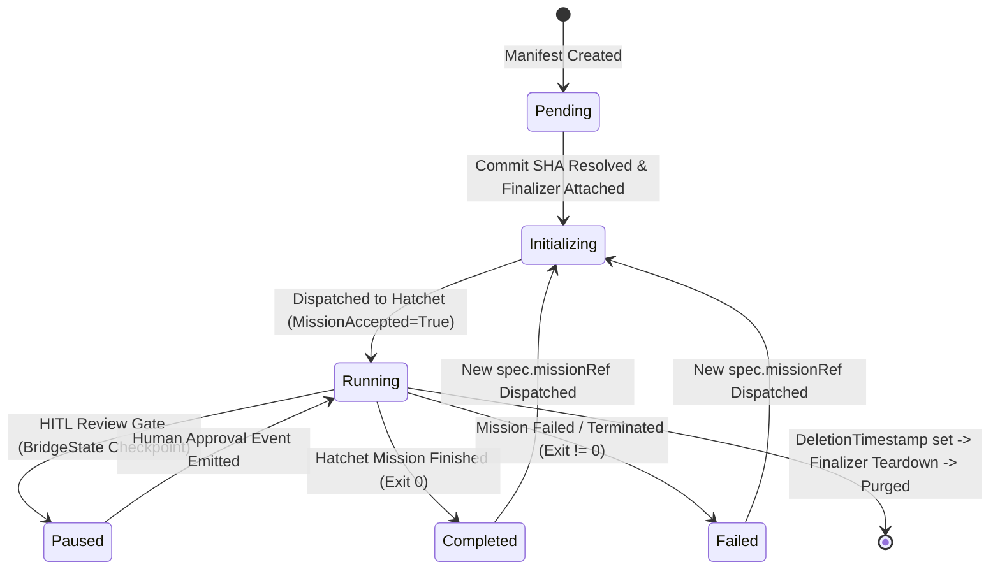

# Data Model: Google AX CRD Workspace Standard (ADR-008 v3.1)

**Feature**: `008-crd-workspace-standard`
**API Version**: `darkgravity.io/v1alpha1`
**Kind**: `AgentWorkspace`

---

## 1. Kubernetes Custom Resource Definition Schema

### CRD Metadata
- **Group**: `darkgravity.io`
- **Version**: `v1alpha1`
- **Kind**: `AgentWorkspace`
- **Plural**: `agentworkspaces`
- **Singular**: `agentworkspace`
- **ShortNames**: `[agws, aws]`
- **Scope**: `Namespaced` (default target namespace: `agents`)

### Rust Type Definition (`kube::CustomResource`)

```rust
use kube::CustomResource;
use schemars::JsonSchema;
use serde::{Deserialize, Serialize};
use k8s_openapi::apimachinery::pkg::apis::meta::v1::Condition;

#[derive(CustomResource, Deserialize, Serialize, Clone, Debug, JsonSchema)]
#[kube(
    group = "darkgravity.io",
    version = "v1alpha1",
    kind = "AgentWorkspace",
    plural = "agentworkspaces",
    namespaced,
    status = "AgentWorkspaceStatus",
    shortname = "agws",
    printcolumn = r#"{"name":"Phase", "type":"string", "jsonPath":".status.phase"}"#,
    printcolumn = r#"{"name":"Mission", "type":"string", "jsonPath":".status.activeMissionRef"}"#,
    printcolumn = r#"{"name":"Commit", "type":"string", "jsonPath":".status.activeMissionCommit"}"#,
    printcolumn = r#"{"name":"Accepted", "type":"string", "jsonPath":".status.conditions[?(@.type=='MissionAccepted')].reason"}"#,
    printcolumn = r#"{"name":"Synced", "type":"string", "jsonPath":".status.conditions[?(@.type=='Synced')].status"}"#,
    printcolumn = r#"{"name":"Run", "type":"string", "jsonPath":".status.hatchetWorkflowRunId", "priority":1}"#,
    printcolumn = r#"{"name":"Age", "type":"date", "jsonPath":".metadata.creationTimestamp"}"#
)]
pub struct AgentWorkspaceSpec {
    /// Git repository clone URL (immutable)
    pub repository_url: String,

    /// Target branch pointer (immutable)
    pub target_branch: String,

    /// Constitution document reference path
    pub constitution_ref: String,

    /// Explicit user-requested mission reference
    #[serde(skip_serializing_if = "Option::is_none")]
    pub mission_ref: Option<String>,

    /// Resource bounds for agent tasks
    pub resource_limits: WorkspaceResourceLimits,
}

#[derive(Deserialize, Serialize, Clone, Debug, JsonSchema)]
pub struct WorkspaceResourceLimits {
    /// Maximum container memory ceiling (e.g., "30Mi")
    pub max_ram: String,

    /// Maximum container CPU ceiling (e.g., "250m")
    pub max_cpu: String,
}

#[derive(Deserialize, Serialize, Clone, Debug, Default, JsonSchema)]
pub struct AgentWorkspaceStatus {
    /// High-level lifecycle phase
    #[serde(default = "default_phase")]
    pub phase: WorkspacePhase,

    /// Active mission reference being orchestrated
    #[serde(skip_serializing_if = "Option::is_none")]
    pub active_mission_ref: Option<String>,

    /// Pinned commit SHA resolved at mission dispatch
    #[serde(skip_serializing_if = "Option::is_none")]
    pub active_mission_commit: Option<String>,

    /// Associated Hatchet workflow run ID
    #[serde(skip_serializing_if = "Option::is_none")]
    pub hatchet_workflow_run_id: Option<String>,

    /// Observed spec generation
    #[serde(default)]
    pub observed_generation: Option<i64>,

    /// Standard k8s lifecycle conditions
    #[serde(default, skip_serializing_if = "Vec::is_empty")]
    pub conditions: Vec<Condition>,
}

#[derive(Deserialize, Serialize, Clone, Copy, Debug, PartialEq, Eq, JsonSchema)]
pub enum WorkspacePhase {
    Pending,
    Initializing,
    Running,
    Paused,
    Completed,
    Failed,
}

fn default_phase() -> WorkspacePhase {
    WorkspacePhase::Pending
}
```

---

## 2. Invariants & CEL Constraints

1. **`repository_url` & `target_branch` Invariance**:
   ```cel
   self.repositoryUrl == oldSelf.repositoryUrl
   self.targetBranch == oldSelf.targetBranch
   ```
2. **`resource_limits` Bounds**:
   ```cel
   isQuantity(self.maxRam) && quantity(self.maxRam).isGreaterThan(quantity('0')) && quantity(self.maxRam).compareTo(quantity('30Mi')) <= 0
   isQuantity(self.maxCpu) && quantity(self.maxCpu).isGreaterThan(quantity('0')) && quantity(self.maxCpu).compareTo(quantity('250m')) <= 0
   ```
3. **String Bounds (`maxLength`)**:
   - `repository_url`: $\le 512$
   - `target_branch`: $\le 255$
   - `constitution_ref`: $\le 512$
   - `mission_ref`: $\le 128$
   - `max_ram` & `max_cpu`: $\le 16$

---

## 3. Entity State Transitions



