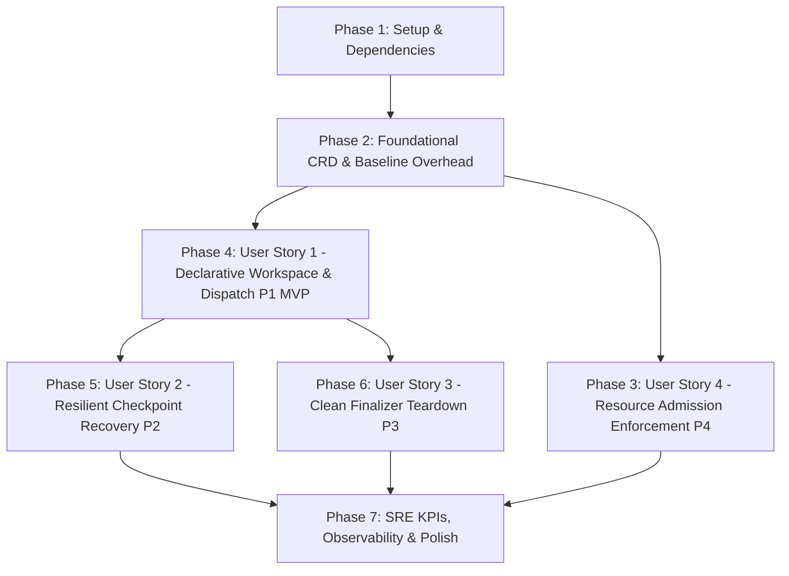

# Tasks: Google AX CRD Workspace Standard (ADR-008 v3.1)

**Input**: Design documents from `specs/008-crd-workspace-standard/`
**Prerequisites**: [plan.md](plan.md), [spec.md](spec.md), [data-model.md](data-model.md), [research.md](research.md), [contracts/](contracts/)

---

## Execution Overview & Dependency Graph

---

## Phase 1: Setup & Shared Infrastructure

**Purpose**: Configure dependencies, deploy directory scaffolding, and register shared crates.

- [x] T001 Add `k8s-openapi` (v1_30), `kube` (0.98 runtime/client/derive), and `schemars` dependencies to `crates/factory-cli/Cargo.toml`
- [x] T002 [P] Create GitOps deployment directory structure in `deploy/crds/` and `deploy/policies/`
- [x] T003 [P] Copy CRD manifest contract from `specs/008-crd-workspace-standard/contracts/crd-agentworkspace.yaml` to `deploy/crds/agentworkspaces.darkgravity.io.yaml`
- [x] T004 [P] Copy admission policy contracts from `specs/008-crd-workspace-standard/contracts/validating-admission-policies.yaml` to `deploy/policies/validating-admission-policies.yaml`

---

## Phase 2: Foundational (Blocking Prerequisites)

**Purpose**: Core data structures, gVisor overhead measurement, and operator scaffolding required by all user stories.

**⚠️ CRITICAL**: Must be verified before proceeding to feature reconciliation.

- [x] T005 Measure steady-state and peak RSS of gVisor (`runsc` Sentry/Gofer) using a diagnostic pod in `development` namespace to validate Option (X) baseline in `specs/008-crd-workspace-standard/research.md`
- [x] T006 Define `AgentWorkspace`, `AgentWorkspaceSpec`, `WorkspaceResourceLimits`, and `AgentWorkspaceStatus` structs in `crates/factory-cli/src/operator/crd.rs` per `specs/008-crd-workspace-standard/data-model.md`
- [x] T007 Implement CRD generation unit test in `crates/factory-cli/src/operator/crd.rs` ensuring OpenAPI schema matches `deploy/crds/agentworkspaces.darkgravity.io.yaml`
- [x] T008 Scaffold `factory-cli operator` command with CLI flags (`--leader-election`, `--namespace`) in `crates/factory-cli/src/main.rs` and `crates/factory-cli/src/operator/mod.rs`
- [x] T009 Implement Kubernetes leader election lock (`coordination.k8s.io/v1` `Lease`) in `crates/factory-cli/src/operator/mod.rs`

**Checkpoint**: Foundation ready — domain models, CLI entry point, and gVisor budget verified.

---

## Phase 3: User Story 4 - Resource Bound Enforcement at Admission (Priority: P4)

**Goal**: Guarantee strict boundary enforcement ($\le 30\text{Mi RAM}$, $\le 250\text{m CPU}$) rejecting non-compliant manifests before etcd persistence.

**Independent Test**: Execute tests in `specs/008-crd-workspace-standard/quickstart.md#2-validation-scenario-1-admission-boundary-enforcement-sc-005` and verify 100% rejection of violations.

- [x] T010 [P] [US4] Implement unit test suite verifying CEL validation rules for `maxRam` and `maxCpu` in `crates/factory-cli/src/operator/admission_test.rs`
- [x] T011 [P] [US4] Create automated test runner script `tests/admission/test_admission_bounds.sh` targeting Kubernetes `ValidatingAdmissionPolicy`
- [x] T012 [US4] Deploy `deploy/policies/validating-admission-policies.yaml` to the development cluster and configure `ValidatingAdmissionPolicyBinding` for namespace `development`
- [x] T013 [US4] Verify admission rejection for missing requests/limits, RAM $> 30\text{Mi}$, CPU $> 250\text{m}$, and ephemeral containers via `tests/admission/test_admission_bounds.sh`

---

## Phase 4: User Story 1 - Declarative Workspace & Mission Requests (Priority: P1) 🎯 MVP

**Goal**: Deliver GitOps-native lifecycle management for `AgentWorkspace`, dispatching missions to Hatchet with commit pinning, idempotency, and throttled one-way status projection.

**Independent Test**: Apply an `AgentWorkspace` manifest with `missionRef`, verify single execution dispatch pinned to Git commit SHA, and inspect formatted columns using `kubectl get agws`.

- [x] T014 [US1] Implement Git commit resolver in `crates/factory-cli/src/operator/git_resolver.rs` to snapshot `targetBranch` to commit SHA and compute constitution hash
- [x] T015 [US1] Implement Hatchet workflow dispatcher with idempotency key `(workspace_uid, mission_ref)` and queueing concurrency in `crates/factory-cli/src/operator/hatchet_sync.rs`
- [x] T016 [US1] Implement throttled status projection engine in `crates/factory-cli/src/operator/controller.rs` emitting patches only on major phases (`Pending`, `Initializing`, `Running`, `Paused`, `Completed`, `Failed`)
- [x] T017 [US1] Implement `MissionAccepted` condition logic in `crates/factory-cli/src/operator/controller.rs` handling `Dispatched`, `MissionActive` (deferred), and `AlreadyExecuted`
- [x] T018 [US1] Implement level-triggered reconciliation poller (60-second tick) in `crates/factory-cli/src/operator/controller.rs` to resume deferred missions after active runs terminate
- [x] T019 [US1] Wire `kube::runtime::Controller` reconcile loop in `crates/factory-cli/src/operator/controller.rs` linking Git resolver, Hatchet dispatcher, and throttled status writer
- [x] T020 [US1] Add integration test for declarative workspace onboarding and `kubectl get agws` printer columns in `crates/factory-cli/tests/operator_integration_test.rs`

---

## Phase 5: User Story 2 - Resilient Checkpoint Recovery (Priority: P2)

**Goal**: Ensure worker pod crashes resume from MinIO S3 `StepCheckpoint` without duplicate tool executions within $< 45\text{ s}$ MTTR.

**Independent Test**: Terminate an active task execution pod and observe Hatchet DAG step resumption from the latest checkpoint without re-running verified steps.

- [x] T021 [P] [US2] Implement checkpoint verification helper in `crates/factory-application/src/workspaces/checkpoints.rs` to validate `StepCheckpoint` state before resuming DAG step
- [ ] T022 [US2] Configure Hatchet DAG task step retry and pod failure handler with at-least-once idempotency semantics in `crates/factory-application/src/workflows/resilience.rs`
- [ ] T023 [US2] Implement fault-injection crash recovery benchmark test in `crates/factory-cli/tests/crash_recovery_test.rs` verifying MTTR $< 45\text{ s}$

---

## Phase 6: User Story 3 - Clean Workspace Deprovisioning & Finalizer Teardown (Priority: P3)

**Goal**: Bounded asynchronous teardown on deletion, cancelling runs, revoking credentials, deleting sandboxes, and sweeping orphaned executions.

**Independent Test**: Delete an active workspace and verify workflow cancellation, token revocation, sandbox cleanup, and finalizer release.

- [ ] T024 [US3] Implement finalizer registration (`darkgravity.io/workspace-finalizer`) upon workspace creation in `crates/factory-cli/src/operator/finalizer.rs`
- [ ] T025 [US3] Implement asynchronous cancellation sequence in `crates/factory-cli/src/operator/finalizer.rs` with `T_cancel = 300s` timeout
- [ ] T026 [US3] Implement Vault JIT credential revocation with `T_token` fallback in `crates/factory-cli/src/operator/finalizer.rs`
- [ ] T027 [US3] Implement sandbox Pod/Job cleanup in namespace `development` matching workspace UID in `crates/factory-cli/src/operator/finalizer.rs`
- [ ] T028 [US3] Implement background orphan sweeper task (120-second interval, 600-second grace period) in `crates/factory-cli/src/operator/orphan_sweeper.rs`
- [ ] T029 [US3] Add automated E2E teardown verification test in `crates/factory-cli/tests/teardown_test.rs`

---

## Phase 7: SRE KPIs, Observability & Polish

**Purpose**: Validate industrialization metrics, telemetry, and documentation synchronization.

- [ ] T030 [P] Implement Prometheus metrics exporter in `crates/factory-cli/src/operator/metrics.rs` tracking status write count per mission and active reconciliations
- [ ] T031 [P] Verify status patch write ratio ($\le 6$ patches per mission) across 5 full simulated mission lifecycles in `crates/factory-cli/tests/write_rate_test.rs`
- [ ] T032 Run OKF incremental documentation script `.agents/tools/okf_generator.py` to update architecture wiki with operator components per workspace rules
- [ ] T033 Run `graphify update .` to keep knowledge graph synchronized with newly created operator modules

---

## Dependencies & Sequencing Strategy

1. **Phase 1 & 2** are strict prerequisites for all subsequent work.
2. **Phase 3 (US4)** and **Phase 4 (US1)** can proceed independently once Phase 2 completes. US1 is the primary MVP increment.
3. **Phase 5 (US2)** and **Phase 6 (US3)** depend on US1 dispatch logic.
4. **Phase 7** consolidates metrics and runs repository-mandated documentation tools.

### Parallel Execution Opportunities
- `T002`, `T003`, `T004` (Phase 1 scaffolding & file copying) can run in parallel.
- `T010` (CEL unit tests) and `T011` (Admission shell runner) can run in parallel.
- `T021` (Checkpoint helper) can run in parallel with finalizer development.
- `T030` and `T031` (Observability and write rate benchmarking) can run in parallel.

