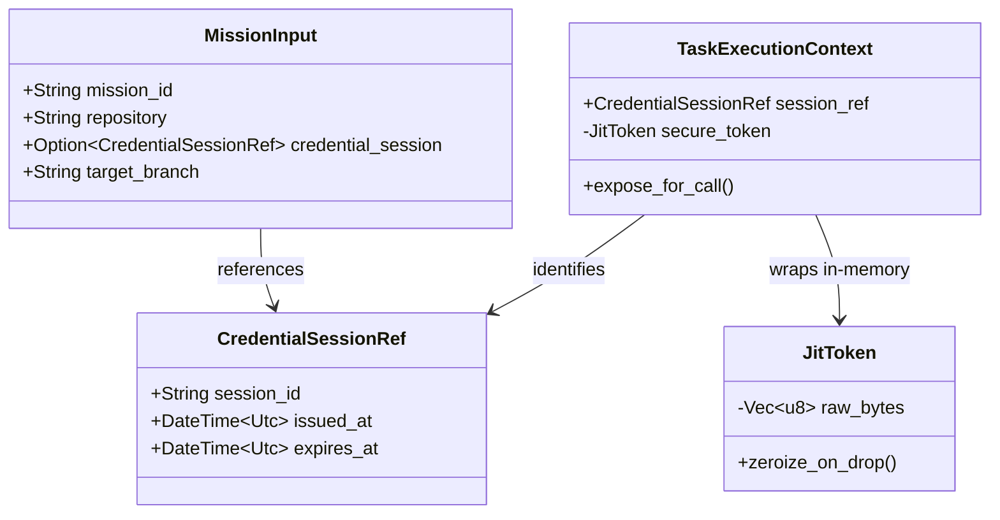

# Data Models: Security Audit Remediation

**Feature**: `009-security-audit-remediation`
**Date**: 2026-11-02

## 1. Non-Serialized Credential Reference Pattern



### Struct Definitions

```rust
#[derive(Serialize, Deserialize, Debug, Clone, PartialEq, Eq)]
pub struct CredentialSessionRef {
    pub session_id: String,
    pub repository: String,
    pub issued_at: chrono::DateTime<chrono::Utc>,
    pub expires_at: chrono::DateTime<chrono::Utc>,
}

#[derive(Serialize, Deserialize, Clone, Default)]
pub struct MissionInput {
    pub mission_id: String,
    pub repository: String,
    #[serde(default)]
    pub credential_ref: Option<CredentialSessionRef>,
    pub issue_url: Option<String>,
}

// Redact debug output
impl std::fmt::Debug for MissionInput {
    fn fmt(&self, f: &mut std::fmt::Formatter<'_>) -> std::fmt::Result {
        f.debug_struct("MissionInput")
            .field("mission_id", &self.mission_id)
            .field("repository", &self.repository)
            .field("credential_ref", &self.credential_ref)
            .field("issue_url", &self.issue_url)
            .finish()
    }
}
```

---

## 2. Vault Token Validation Claims

```rust
#[derive(Debug, Clone, Serialize, Deserialize)]
pub struct VaultTokenClaims {
    pub accessor: String,
    pub policies: Vec<String>,
    pub metadata: VaultTokenMetadata,
    pub expire_time: chrono::DateTime<chrono::Utc>,
    pub renewable: bool,
    pub ttl_secs: u64,
}

#[derive(Debug, Clone, Serialize, Deserialize)]
pub struct VaultTokenMetadata {
    pub audience: String,
    pub agent_id: String,
    pub isolated_path: String,
}

pub struct TokenValidationPolicy {
    pub expected_repo: String,
    pub expected_agent_id: String,
    pub required_policy: String,
    pub max_remaining_ttl: std::time::Duration,
}
```

---

## 3. NHI Issuer Trust & Nonce Registry

```rust
pub trait IssuerTrustStore: Send + Sync {
    fn is_trusted_issuer(&self, issuer_did: &str, verifying_key: &ed25519_dalek::VerifyingKey) -> bool;
}

pub struct NonceReplayCache {
    seen_nonces: std::sync::RwLock<std::collections::HashMap<String, chrono::DateTime<chrono::Utc>>>,
    ttl: std::time::Duration,
}

impl NonceReplayCache {
    pub fn check_and_record(&self, nonce: &str, now: chrono::DateTime<chrono::Utc>) -> Result<(), SecurityError>;
}
```

---

## 4. Evidence Report Schema Normalization

```rust
#[derive(Debug, Clone, Serialize, Deserialize)]
pub struct MissionEvidenceReport {
    pub mission_id: String,
    pub repository: String,
    pub execution_duration_secs: u64,
    pub cost_usd: f64,
    pub delivery: DeliveryMetadata,
    pub resource_metrics: ExecutionResourceMetrics,
}

#[derive(Debug, Clone, Serialize, Deserialize)]
pub struct DeliveryMetadata {
    pub platform: String,
    pub repository: String,
    pub pull_request_number: u64,
    pub pull_request_url: String,
    pub commit_sha: String,
    pub delivery_timestamp: chrono::DateTime<chrono::Utc>,
}

#[derive(Debug, Clone, Serialize, Deserialize)]
pub struct ExecutionResourceMetrics {
    pub worker_host_cpu_max_cores: f64,
    pub worker_host_memory_max_mib: u64,
    pub gvisor_sandbox_cpu_limit_cores: f64,
    pub gvisor_sandbox_memory_limit_mib: u64,
    pub gvisor_sandbox_cpu_peak_cores: f64,
    pub gvisor_sandbox_memory_peak_mib: u64,
}
```
