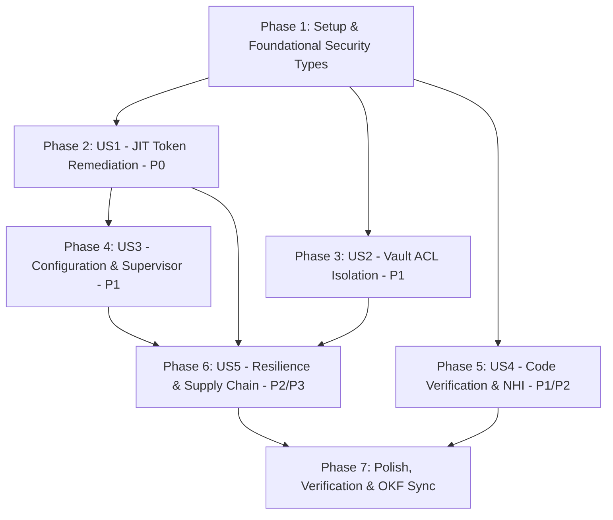

# Tasks: Technical Security Audit Remediation

**Feature**: `009-security-audit-remediation`
**Spec**: [spec.md](file:///mnt/F024B17C24B145FE/Repos/rust_CACD_autonomous_factory/specs/009-security-audit-remediation/spec.md)
**Plan**: [plan.md](file:///mnt/F024B17C24B145FE/Repos/rust_CACD_autonomous_factory/specs/009-security-audit-remediation/plan.md)

---

## Dependencies & Execution Order

---

## Phase 1: Setup & Foundational Security Types

- [x] T001 [P] Define `CredentialSessionRef` and zeroizing credential containers in `crates/factory-core/src/security.rs` (Issue #562)
- [x] T002 [P] Establish mock Vault test server fixtures and policy definitions in `crates/factory-infrastructure/tests/` (Issue #563)

---

## Phase 2: User Story 1 - Non-Serializable JIT Token Isolation (P0)

**Goal**: Eliminate raw bearer tokens (`Option<String>`) from serialized `MissionInput`, redact debug outputs, and enforce `ZeroizeOnDrop` lifecycle.

- [x] T003 [US1] Write failing test for `MissionInput` serialization verifying no bearer token is present in JSON in `crates/factory-application/tests/mission_input_security_tests.rs` (Issue #564)
- [x] T004 [US1] Refactor `MissionInput` in `crates/factory-application/src/workflows/autonomous_mission.rs` to remove `pub jit_token: Option<String>` and adopt `credential_ref: Option<CredentialSessionRef>` (Issue #565)
- [x] T005 [US1] Implement custom `Debug` implementation for `MissionInput` and execution contexts redacting sensitive fields in `crates/factory-application/src/workflows/autonomous_mission.rs` (Issue #566)
- [x] T006 [US1] Create in-memory `TaskExecutionContext` wrapping `JitToken` with `zeroize::ZeroizeOnDrop` semantics in `crates/factory-core/src/security.rs` (Issue #567)
- [x] T007 [US1] Verify TDD test passes and assert zero secret leakage across step transitions (Issue #568)

---

## Phase 3: User Story 2 - Strict Vault Repository Policy Isolation & Token Authorization (P1)

**Goal**: Enforce deterministic Vault ACL boundaries per repository (`repo-a` vs `repo-b`), token validation claims, and client timeouts.

- [x] T008 [US2] Write failing integration test verifying cross-repository access denial (`org/repo-a` cannot read `secret/data/repos/org/repo-b/*`) in `crates/factory-infrastructure/tests/vault_isolation_tests.rs` (Issue #569)
- [x] T009 [US2] Wrap `role_token` into secure zeroizing type and configure explicit HTTP timeouts and retry policies on `reqwest::Client` in `crates/factory-infrastructure/src/vault.rs` (Issue #570)
- [x] T010 [US2] Enhance `validate_token()` in `crates/factory-infrastructure/src/vault.rs` to verify attached policy matches `repo-<sanitized_repo>`, audience matches repository, and agent identity matches expected ID (Issue #571)
- [x] T011 [US2] Ensure token issuance binds tokens to explicit Vault ACL path policies rather than relying purely on token metadata claims in `crates/factory-infrastructure/src/vault.rs` (Issue #572)
- [x] T012 [US2] Run Vault isolation test suite and confirm green status (Issue #573)

---

## Phase 4: User Story 3 - Hardened Configuration & Task Supervisor (P1)

**Goal**: Fail fast without insecure default credentials in non-development profiles, and supervise background monitors with cooperative cancellation.

- [x] T013 [US3] Add unit test in `crates/factory-application/tests/config_tests.rs` verifying startup panic/abort when `R2R_SUPERUSER_EMAIL` or `R2R_SUPERUSER_PASSWORD` are missing in production mode (Issue #574)
- [x] T014 [US3] Remove hardcoded fallback credentials (`admin@example.com` / `admin`) in `crates/factory-application/src/workflows/autonomous_mission.rs`, enforcing environment checks (Issue #575)
- [x] T015 [US3] Introduce `tokio_util::sync::CancellationToken` and task tracking handle for background monitors (`FinOpsAgent`, Sentry) in `crates/factory-application/src/workflows/autonomous_mission.rs` (Issue #576)
- [x] T016 [US3] Verify graceful shutdown and cancellation signal propagation in workflow execution (Issue #577)

---

## Phase 5: User Story 4 - Multi-Layer Code Verification & NHI Hardening (P1/P2)

**Goal**: Supplement regex heuristics with AST validation, bound batch crypto concurrency, and enforce NHI issuer trust & replay prevention.

- [x] T017 [US4] Write failing unit tests for adversarial holdout mutations and loop evasions in `crates/factory-core/tests/security_analyzer_tests.rs` (Issue #578)
- [x] T018 [US4] Implement AST-aware parser checks (`syn`) for Rust diffs alongside existing regex tripwires in `crates/factory-core/src/security.rs` (Issue #579)
- [x] T019 [US4] Implement `IssuerTrustStore` trait and `NonceReplayCache` in `crates/factory-core/src/security/nhi.rs` to validate issuer key trust and reject replayed nonces (Issue #580)
- [x] T020 [US4] Bound asynchronous batch signing and verification (`sign_batch_async`, `verify_batch_async`) using a `tokio::sync::Semaphore` in `crates/factory-core/src/security/nhi.rs` (Issue #581)
- [x] T021 [US4] Bound `circuit_breaker.rs` diff history with a fixed capacity limit and add state persistence checkpoint support in `crates/factory-application/src/workflows/circuit_breaker.rs` (Issue #582)

---

## Phase 6: User Story 5 - True Resilience, Evidence Normalization & CI Supply Chain (P2/P3)

**Goal**: Implement kill-recovery fault tests, normalize `report.json` metrics, and pin GitHub Actions.

- [x] T022 [US5] Implement fault injection test verifying PR delivery idempotency upon simulated worker kill before checkpoint in `crates/factory-application/tests/fault_injection_tests.rs` (Issue #583)
- [x] T023 [US5] Normalize evidence schema in `evidence/missions/mission-001/report.json`, clearly distinguishing host worker resources from gVisor sandbox limits and replacing mock commit hashes (Issue #584)
- [x] T024 [US5] Pin all third-party GitHub Actions in `.github/workflows/pipeline.yml` to immutable 40-character commit SHAs (Issue #585)

---

## Phase 7: Polish & Documentation Sync

- [x] T025 Execute workspace test suite: `cargo test --workspace` (Issue #586)
- [x] T026 Execute Clippy and formatting checks: `cargo clippy --workspace --all-targets -- -D warnings` && `cargo fmt --check` (Issue #587)
- [x] T027 Update OKF documentation and knowledge graph via `.agents/tools/okf_generator.py` and `graphify update .` (Issue #588)
- [x] T028 Present PR link and test evidence to user for manual human review and merge (HITL policy) (Issue #589)

