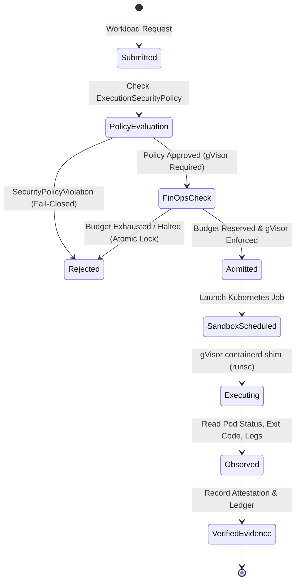

# Data Model: DG-RVP-013: Verified Autonomous Execution Closure

## 1. Execution Security Policy

```rust
#[derive(Debug, Clone, Copy, PartialEq, Eq, Serialize, Deserialize)]
pub enum ExecutionEnvironment {
    Production,
    Staging,
    Development,
    Test,
}

#[derive(Debug, Clone, Copy, PartialEq, Eq, Serialize, Deserialize)]
pub enum WorkloadTrustLevel {
    Untrusted,
    TrustedInternal,
}

#[derive(Debug, Clone, PartialEq, Eq, Serialize, Deserialize)]
pub enum SandboxIsolationType {
    KubernetesGVisor {
        runtime_class: String,
        namespace: String,
    },
    HostSubprocessAllowedOnlyForTrustedDev,
}

#[derive(Debug, Clone, PartialEq, Eq, Serialize, Deserialize)]
pub struct ExecutionSecurityPolicy {
    pub environment: ExecutionEnvironment,
    pub trust_level: WorkloadTrustLevel,
    pub isolation: SandboxIsolationType,
}

#[derive(Debug, Clone, PartialEq, Eq, Serialize, Deserialize)]
pub enum SecurityPolicyViolation {
    ForbiddenHostExecutionInProduction,
    ForbiddenHostExecutionForUntrustedWorkload,
    ForbiddenIsolationDowngrade,
    InvalidNamespace(String),
    MissingRuntimeConfiguration(String),
    FailClosed(String),
}
```

## 2. Truthful Observed Runtime Attestation

```rust
#[derive(Debug, Clone, Serialize, Deserialize, PartialEq, Eq)]
pub struct ObservedClusterExecution {
    pub cluster_id: Option<String>,
    pub node_name: Option<String>,
    pub job_name: String,
    pub pod_name: Option<String>,
    pub pod_uid: Option<String>,
    pub container_id: Option<String>,
    pub container_image_digest: Option<String>,
    pub runtime_class_requested: String,
    pub runtime_type_observed: Option<String>,
    pub seccomp_profile: String,
    pub capabilities_dropped: Vec<String>,
    pub is_root: bool,
    pub exit_code: Option<i32>,
    pub command_hash: String,
    pub duration_ms: u64,
    pub observed_at: chrono::DateTime<chrono::Utc>,
}

#[derive(Debug, Clone, Serialize, Deserialize, PartialEq, Eq)]
pub struct ExecutionResult {
    pub stdout: String,
    pub stderr: String,
    pub exit_code: Option<i32>,
    pub is_success: bool,
    pub attestation: Option<ObservedClusterExecution>,
}
```

## 3. Atomic FinOps Transactional State

```rust
#[derive(Debug, Clone, Serialize, Deserialize, PartialEq)]
pub struct FinOpsStopState {
    pub halted: bool,
    pub state_version: u64,
    pub reason: Option<String>,
    pub current_spend: f64,
    pub max_daily_budget: f64,
    pub reserved_spend: f64,
    pub updated_at: chrono::DateTime<chrono::Utc>,
}

#[derive(Debug, Clone, Serialize, Deserialize, PartialEq)]
pub struct BudgetReservationReceipt {
    pub mission_id: String,
    pub reserved_amount: f64,
    pub state_version: u64,
    pub timestamp: chrono::DateTime<chrono::Utc>,
}
```

## 4. State Transitions

### Execution Admission State Machine


