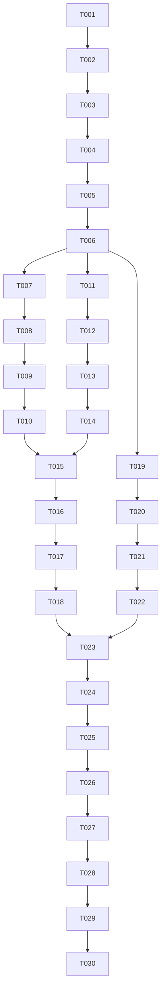

# Tasks: DG-RVP-013: Verified Autonomous Execution Closure

**Input**: Design documents from `specs/013-verified-autonomous-execution-closure/` (`spec.md`, `plan.md`, `research.md`, `data-model.md`, `contracts/`, `quickstart.md`, `verification-matrix.md`)  
**Prerequisites**: `plan.md`, `spec.md`, `research.md`, `data-model.md`, `contracts/execution-contracts.md`  
**Organization**: Grouped into phases by user story and execution layers (Foundation, US1, US2, US3, US4, US5, Polish).  

## Format: `[TaskID] [P?] [Story?] Description with file path`
- **[P]**: Parallelizable (independent files and dependencies)
- **[Story]**: Mapped to User Stories (`[US1]`, `[US2]`, `[US3]`, `[US4]`, `[US5]`)

---

## Phase 1: Setup & Baseline Discovery

**Purpose**: Baseline verification, environment stabilization, and repository state validation across all 4 target repositories.

- [ ] T001 Retrieve and record latest HEAD commit SHAs across `rust_CACD_autonomous_factory`, `gitops_internal_lgcorzo`, `lgcorzo.github.io`, and `fastapi-autogen-team` in `docs/audit/REMEDIATION_REPORT_013.md`
- [ ] T002 Inspect and verify clean branch states, confirming all local branches are synced with origin/main
- [ ] T003 Validate containerd and gVisor packages on host (`/usr/bin/runsc`, containerd v2.4.2) and document baseline in `docs/audit/GITOPS_RUNTIME_VERIFICATION.md`

---

## Phase 2: Foundational (Core Policy & Domain Models)

**Purpose**: Core domain types in `factory-core` that enforce security boundaries and state consistency before handler implementation.

- [ ] T004 Implement `ExecutionSecurityPolicy`, `ExecutionEnvironment`, `WorkloadTrustLevel`, `SandboxIsolationType`, and `SecurityPolicyViolation` in `crates/factory-core/src/security_policy.rs`
- [ ] T005 [P] Register and export `security_policy` module in `crates/factory-core/src/lib.rs`
- [ ] T006 Implement unit tests for `ExecutionSecurityPolicy` in `crates/factory-core/src/security_policy.rs` verifying fail-closed defaults and rejection of host execution for untrusted workloads

---

## Phase 3: User Story 1 - Unified Fail-Closed Execution Security Policy (Priority: P0) 🎯 MVP

**Goal**: Ensure zero untrusted code can execute directly on the host or bypass gVisor isolation, removing confusing environment overrides and enforcing fail-closed admission.  
**Independent Test**: Execute sandbox unit and integration tests with `USE_GVISOR=false`, `SANDBOX_MODE=subprocess`, and missing configs; assert execution is rejected with typed security errors.

- [ ] T007 [US1] Refactor `crates/factory-mcp-server/src/sandbox.rs` to enforce `ExecutionSecurityPolicy` before invoking `SandboxDriver`
- [ ] T008 [US1] Remove insecure host fallback from `crates/factory-mcp-server/src/tools/launch_sandbox_pod.rs`, making `require_gvisor: true` mandatory for all untrusted mission workloads regardless of `FACTORY_ENV`
- [ ] T009 [US1] Update `SubprocessDriver` in `crates/factory-mcp-server/src/sandbox.rs` to strictly reject execution unless explicitly classified as `TrustedInternal` in development test harnesses
- [ ] T010 [P] [US1] Update `crates/factory-mcp-server/tests/launch_sandbox_pod_tests.rs` with negative security tests verifying `USE_GVISOR=false` and `SANDBOX_MODE=subprocess` cannot bypass sandbox isolation

---

## Phase 4: User Story 2 - Real MicroK8s gVisor Runtime Repair & Execution (Priority: P0)

**Goal**: Correct MicroK8s containerd configuration to bind `runsc` handler to `io.containerd.runsc.v1`, validating real compilation and test execution inside gVisor-backed Pods.  
**Independent Test**: Run a disposable Rust test Pod with `runtimeClassName: gvisor` in namespace `factory-sandboxes`; verify `runsc` kernel emulation, exit code 0, and clean deletion.

- [ ] T011 [US2] Update `/var/snap/microk8s/current/args/containerd-template.toml` and `/var/snap/microk8s/current/args/containerd.toml` to bind `runsc` runtime handler to `runtime_type = "io.containerd.runsc.v1"`
- [ ] T012 [US2] Restart MicroK8s containerd service (`snap restart microk8s.daemon-containerd`) and verify containerd socket readiness
- [ ] T013 [US2] Execute disposable probe Pod in `factory-sandboxes` with `runtimeClassName: gvisor` executing `rustc --version` and capture runtime logs
- [ ] T014 [US2] Execute live negative isolation tests in `factory-sandboxes` (network egress block, host path mount denial) and record results in `evidence/security/live-gvisor-isolation.json`

---

## Phase 5: User Story 3 - Observed Fact-Based Runtime Attestation (Priority: P0)

**Goal**: Transform `SandboxAttestation` to capture truthful, independently observed cluster facts queried directly from the Kubernetes Pod API rather than static configuration echoes.  
**Independent Test**: Run a test mission inside Kubernetes; compare the generated attestation payload against Kubernetes API query results for the target Pod; verify non-null Pod UID, container ID, and image digest.

- [ ] T015 [US3] Refactor `SandboxAttestation` in `crates/factory-mcp-server/src/sandbox.rs` to include `pod_uid`, `node_name`, `container_id`, `container_image_digest`, `runtime_type_observed`, and `command_hash`
- [ ] T016 [US3] Update `crates/factory-mcp-server/src/tools/launch_sandbox_pod.rs` to query the Kubernetes Pod resource after completion via `kube::Client` and populate observed attestation facts
- [ ] T017 [US3] Ensure mock drivers (`RecordingSandboxDriver`) set `attestation: None` or explicit mock indicator, failing validation when submitted for `LIVE_RUNTIME` certification
- [ ] T018 [P] [US3] Add integration test in `crates/factory-mcp-server/tests/launch_sandbox_pod_tests.rs` asserting attestation truthfulness and rejection of mock runtime records

---

## Phase 6: User Story 4 - FinOps Concurrency & Distributed Consistency (Priority: P1)

**Goal**: Eliminate lock target discrepancies in `FileFinOpsStopStore`, implement atomic `check_and_reserve_budget`, and ensure fail-closed budget enforcement under concurrent execution.  
**Independent Test**: Run concurrent multi-threaded admission tests against a simulated budget ceiling; assert that once the limit is exhausted, no requests overspend or race past the latch.

- [ ] T019 [US4] Update `crates/factory-infrastructure/src/finops_stop_store.rs` so that `read_state()` locks `.lock` file with `lock_shared()` and `write_state()` locks `.lock` file with `lock_exclusive()`
- [ ] T020 [US4] Implement `check_and_reserve_budget(mission_id, estimated_cost)` in `crates/factory-infrastructure/src/finops_stop_store.rs` performing atomic check-and-reserve under exclusive lock
- [ ] T021 [US4] Implement atomic file replacement via temporary file and rename in `FileFinOpsStopStore::write_state` to prevent torn reads
- [ ] T022 [P] [US4] Create multi-threaded concurrency unit test in `crates/factory-infrastructure/tests/finops_concurrency_test.rs` validating zero budget over-admission under contention

---

## Phase 7: User Story 5 - Evidence Governance & Public Claims Alignment (Priority: P1)

**Goal**: Align the Evidence Gate with exact repository commit SHAs, update all evidence artifacts, and verify 100% claim consistency on `lgcorzo.github.io`.  
**Independent Test**: Run `scripts/validate_evidence.py` and `pytest tests/test_public_claims.py`; confirm zero discrepancies between evidence ledger, site HTML, and public claims.

- [ ] T023 [US5] Update evidence ledger records in `evidence/` to reference the final Git commit SHA, classifications (`LIVE_RUNTIME`, `SECURITY_NEGATIVE`, etc.), and verified attestations
- [ ] T024 [US5] Update `gitops_internal_lgcorzo` manifests in `infrastructure/agents/` to reflect verified container digests and runtime configurations
- [ ] T025 [US5] Run `flux reconcile kustomization infrastructure -n flux-system` and verify cluster reconciliation status
- [ ] T026 [US5] Validate `data/canonical-claims.json` and footer references in `lgcorzo.github.io`, ensuring `FACT-SANDBOX-ISOLATION` is backed by valid live runtime evidence
- [ ] T027 [P] [US5] Execute test suite in `lgcorzo.github.io` (`pytest tests/test_public_claims.py`) and verify all 5 claim tests pass

---

## Phase 8: Polish & End-to-End Mission Verification

**Purpose**: Final comprehensive verification, audit documentation, and full end-to-end mission check on the live cluster.

- [ ] T028 Execute full workspace linter and test suite (`cargo fmt --check`, `cargo clippy --all-targets -j 1`, `cargo test --workspace -j 1`)
- [ ] T029 Trigger and monitor a real autonomous mission on the Kubernetes cluster using `trigger_mission` and verify all 5 DAG stages complete successfully
- [ ] T030 Compile and finalize `docs/audit/REMEDIATION_REPORT_013.md`, `docs/audit/VERIFICATION_EVIDENCE_REPORT.md`, and `docs/audit/GITOPS_RUNTIME_VERIFICATION.md`

---

## Dependencies & Execution Flow

---

## Implementation Strategy: Incremental Delivery & Verification

1. **Step 1 (Core Foundation & Policy)**: Implement `ExecutionSecurityPolicy` (T004-T006) to guarantee that any further execution requests must satisfy fail-closed criteria.
2. **Step 2 (Runtime Repair)**: Correct the containerd `runsc` handler in MicroK8s (T011-T014) and prove live gVisor execution with disposable probe workloads.
3. **Step 3 (Attestation & FinOps)**: Implement observed Pod telemetry capture (T015-T018) and unified FinOps locking (T019-T022).
4. **Step 4 (Evidence & Public Claims)**: Bind evidence to exact commit SHAs (T023-T027) and reconcile GitOps.
5. **Step 5 (Full End-to-End Mission)**: Run live Hatchet DAG mission across all 5 stages, record logs, and finalize remediation reports.
