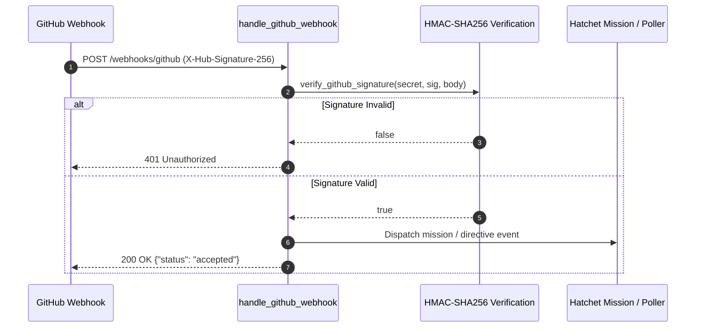

# factory-mcp-server::github_webhook — GitHub Webhook Ingress Route

> **Source**: `crates/factory-mcp-server/src/github_webhook.rs`  
> **Layer**: Interface  
> **Role**: Axum route for GitHub webhook events. The router registers `POST /webhooks/github` unconditionally, so it is enabled at the application level by default. No `Service` or `Ingress` manifest is present in `deploy/` or `config/`, so external exposure is **TO CONFIRM**.

The route is included when the application router is built. Protected mode is enabled when `FACTORY_ENV=production`, the production feature is active, or `MCP_API_BEARER_TOKEN` is configured. In protected mode, a webhook secret is required. In unprotected mode, an empty webhook secret does not require signature validation. The default local configuration is therefore not a signed-webhook requirement; this is a code issue to resolve separately.

---

## Webhook Verification Flow

The HTTP server binds to `0.0.0.0`; that bind address does not itself establish that a Kubernetes Service, Ingress, or external route exposes the endpoint.

---

> *Related: [McpServer](lib.md) · [Tactical Design](../../architecture/tactical_design.md)*
