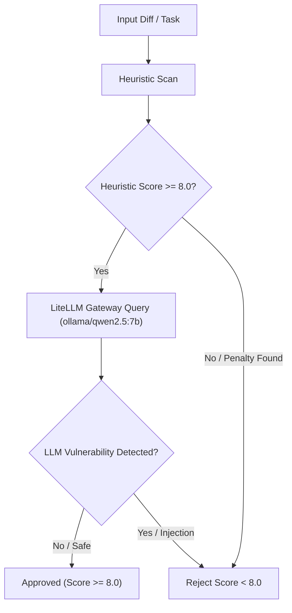

# factory-mcp-server::tools::security_review — SAST Gate

> **Source**: `crates/factory-mcp-server/src/tools/security_review.rs`
> **Layer**: Interface

---

Security review tool: analyzes code diffs or task instructions for security vulnerabilities using LLM SAST (Aethelgard) and heuristic scanning, enforcing an approved threshold of score >= 8.0. Benign functional requests, documentation, and routine code without exploit payloads evaluate to score >= 8.0 approved status.

---

> *Related: [lib.rs](../lib.md) · [Tactical Design](../../../architecture/tactical_design.md)*
