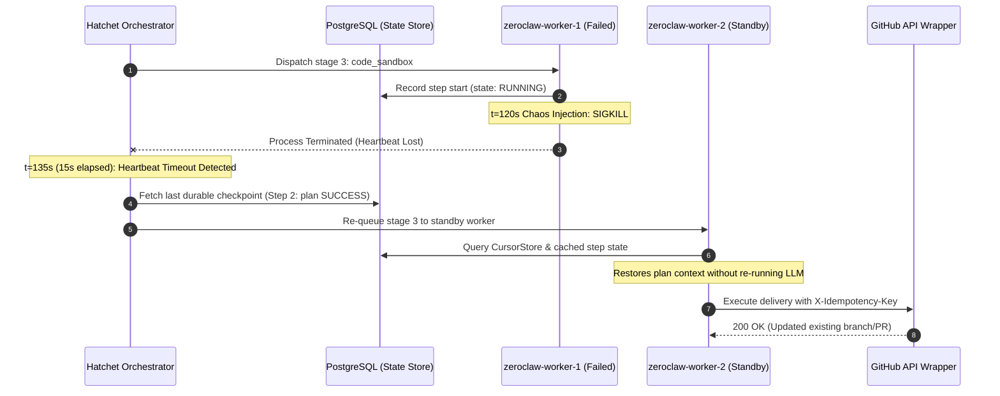

# Engineering Lab Notebook — EXP-2026-006: Interrupted Mission Recovery & Side-Effect Idempotency

> **Source Path**: `evidence/missions/mission-001/recovery-test.json`

---

## 1. Intent & Objective

The objective of experiment **EXP-2026-006** is to prove that upon an abrupt pod failure, node eviction, or ungraceful worker process crash (`SIGKILL`) during autonomous mission execution, the Hatchet durable orchestrator resumes the DAG execution from the last completed checkpoint without re-running completed LLM inferences or duplicating external side-effects (Git commits, PR creation, external webhooks).

---

## 2. Configuration & Protocol

### 2.1 Target Workflow & DAG Stages
- **Orchestrator**: Hatchet Durable Orchestrator Engine (`v0.42.1`)
- **Target DAG Pipeline**: `[ingestion -> plan -> code_sandbox -> validation -> delivery]`
- **Mission ID**: `mission-001`

### 2.2 Fault Injection & Chaos Parameters
- **Injection Event**: Chaos process kill (`SIGKILL` / signal 9) injected directly into active worker `zeroclaw-worker-1` process.
- **Trigger Timing**: Second `t=120s` during active code synthesis in stage `code_sandbox`.
- **Target Container**: gVisor sandbox runner executing ZeroClaw agent tasks.

### 2.3 Idempotency Key Specification
To enforce strict idempotency across external API wrappers, requests sent to external service boundaries (GitHub API, GitLab API, webhook endpoints) carry a deterministic idempotency header:

```http
X-Idempotency-Key: sha256(mission_id + stage_name)
```

For mission `mission-001` and stage `delivery`:
$$\text{Key} = \text{SHA256}(\text{"mission-001delivery"}) = \text{8a9b0c...3d2e}$$

---

## 3. Reality & Recovery Execution Timeline



### 3.1 Execution Chronology

1. **`t=0s` - Ingestion**: Mission `mission-001` ingested and validated by `PollerDaemonService`. Checkpoint persisted.
2. **`t=12s` - Plan Stage**: `RustantAgent` formulates SDD execution blueprint (Tasks T001–T005). Checkpoint persisted in PostgreSQL (`hatchet_step_runs`).
3. **`t=57s` - Code Sandbox Stage**: `ZeroClawAgent` initiated in isolated gVisor pod (`zeroclaw-worker-1`). Code synthesis and TDD execution underway.
4. **`t=120s` - Chaos SIGKILL Injected**: Kernel sends `SIGKILL` to `zeroclaw-worker-1` PID during active code generation.
5. **`t=135s` - Heartbeat Loss Detection**: Hatchet engine detects worker heartbeat timeout at 15 seconds.
6. **`t=136s` - State Restoration**: Standby worker (`zeroclaw-worker-2`) claims re-queued step task. Restores step 2 (`plan`) state directly from PostgreSQL state store without repeating LLM inference calls.
7. **`t=180s` - Idempotent External Delivery**: GitHub API wrapper receives request with `X-Idempotency-Key = sha256("mission-001delivery")`. Updates existing remote branch (`mission-lgcorzo-rust_CACD_autonomous_factory-1`) and PR `#1` instead of creating duplicate branches or pull requests.

---

## 4. Side-Effect & Idempotency Analysis Matrix

| Metric / Side-Effect | Worker Attempt 1 (Interrupted) | Worker Attempt 2 (Resumed Standby) | Verification Result |
| :--- | :--- | :--- | :--- |
| **LLM Inference Re-execution** | Step 2 inferences executed ($0.4285\text{ USD}$) | Re-used step 2 state from PostgreSQL ($0\text{ token cost}$) | **0 Duplicate Inferences** |
| **Git Branch Creation** | Created `mission-lgcorzo-rust_CACD_autonomous_factory-1` | Detected existing branch via idempotency key | **1 Branch total** (Zero duplicates) |
| **GitHub Pull Request** | PR `#1` created / linked | Updated existing PR `#1` | **1 PR total** (Zero duplicates) |
| **External Webhooks** | Payload generated; withheld pending step completion | Transmitted upon step verification | **1 Webhook delivered** |
| **State Persistence** | Intermediate state in `hatchet_step_runs` | Final status `COMPLETED` committed | **Consistent State** |

---

## 5. Lessons Learned

1. **Durable Checkpoint Granularity**: Step checkpointing in durable orchestrators (Hatchet) must be combined with deterministic idempotency keys in external API tooling wrappers to prevent duplicate side effects.
2. **Heartbeat Tuning**: A 15-second heartbeat loss threshold provides optimal balance between rapid failover detection and avoiding false positives during high-load CPU spikes.
3. **Cached LLM State**: Caching intermediate reasoning and SDD task plans in durable database stores eliminates redundant expensive model calls on failover retries.

---

## 6. Industrial Transfer Applications

### CAD/CAM Nesting Pipelines (Lantek Integration)
This verification result is critical for long-running industrial automation workloads, such as **CAD/CAM sheet metal nesting optimization algorithms** (e.g., Lantek MES integration):
- **Computation Protection**: High-compute sheet metal nesting runs (which can take minutes to hours) store intermediate geometry layouts to durable state. Transient server failures or pod evictions do not restart expensive nesting computations from scratch.
- **MES Order Safety**: Deterministic idempotency keys (`X-Idempotency-Key`) ensure that re-sent manufacturing execution system (MES) orders or cutting instructions do not duplicate material orders or produce redundant physical laser/plasma cutting jobs on the shop floor.

---

> *Related: [Experiment Logs](experiment_logs.md) · [Production Operations](production_operations.md) · [Runtime Sequences](../architecture/runtime_sequences.md)*
