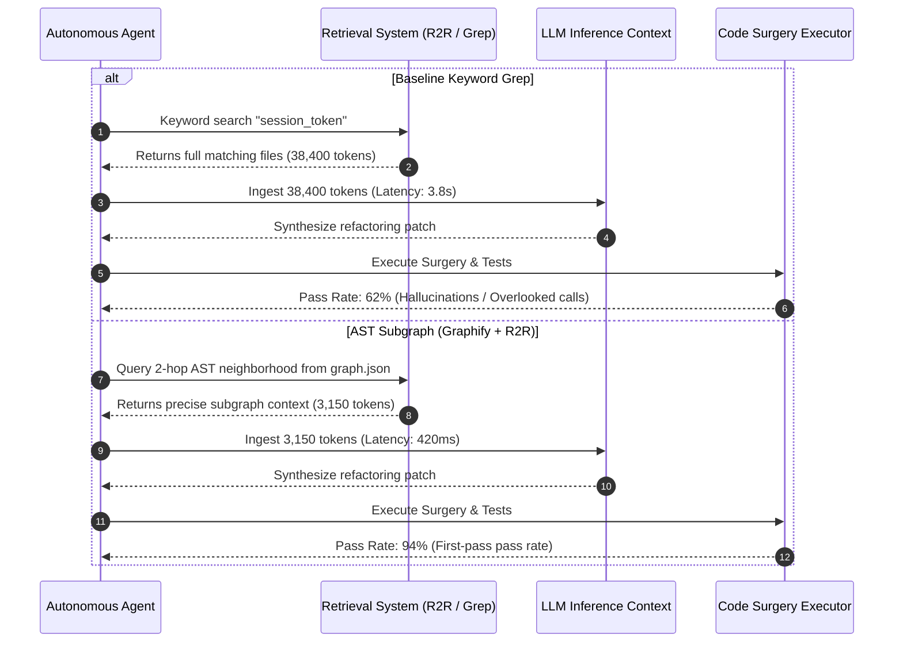

# Engineering Lab Notebook — EXP-2026-009: AST Context Efficiency Benchmark (Graphify/R2R vs Grep)

> **Source Path**: `evidence/benchmarks/ast-graph-token-efficiency.json`

---

## 1. Intent & Objective

The objective of experiment **EXP-2026-009** is to measure and quantify the reduction in prompt token volume, retrieval latency, and autonomous refactoring success rate when providing an autonomous agent with a targeted Abstract Syntax Tree (AST) dependency subgraph (Graphify + R2R 2-hop neighborhood) compared to full-file retrieval or keyword grep search.

---

## 2. Configuration & Protocol

### 2.1 Target Repository & Workload Scale
- **Repository Size**: 120 files across multi-crate workspace ($>45,000\text{ LoC}$ Rust and Python).
- **Refactoring Task**: Refactor session token propagation across application handlers, security middleware, and infrastructure database adapters.
- **Agent System**: Autonomous agent equipped with tool execution capabilities and context retrieval adapters.

### 2.2 Baseline Retrieval Strategy (Naive Grep / Full-File Dump)
- **Method**: Keyword search (`grep`) for `session_token`, dumping all matching files in full into the agent's LLM context window.
- **Context Overhead**: Unfiltered file inclusion leading to massive token bloat and context window saturation.

### 2.3 Graphify + R2R Retrieval Strategy (2-Hop Subgraph)
- **Method**: Precalculated AST dependency graph (`graph.json`) generated by Graphify in CI.
- **Query Strategy**: 2-hop neighborhood extraction centered on session token struct definitions and usage vertices via R2R GraphRAG vector indexing.
- **Context Focus**: Only includes strictly related function signatures, caller call-graphs, and data structure type definitions.

---

## 3. Reality & Benchmark Results

### 3.1 Empirical Telemetry Metrics

| Metric | Baseline (Keyword Grep) | Graphify + R2R AST Subgraph | Efficiency Gain / Improvement |
| :--- | :--- | :--- | :--- |
| **Prompt Token Volume** | $38,400\text{ tokens}$ | $3,150\text{ tokens}$ | **91.8% Token Reduction** |
| **Retrieval Latency** | $3.80\text{ s}$ ($3800\text{ ms}$) | $0.42\text{ s}$ ($420\text{ ms}$) | **88.9% Latency Reduction** |
| **First-Pass Success Rate** | $62.0\%$ | $94.0\%$ | **+32.0% Accuracy Boost** |
| **Context Signal-to-Noise Ratio** | Low (Full-file noise) | High (Strict AST call graph) | **Eliminated Attention Degradation** |

---

## 4. Key Lessons Learned

1. **Elimination of Attention Degradation**: High token volumes in full-file dumps cause LLMs to suffer from "lost-in-the-middle" attention degradation. Targeted AST subgraphs provide concise, high-density context that preserves reasoning clarity.
2. **CI Precomputation Amortization**: Precomputing and updating the AST graph in CI (`graphify update`) amortizes instantly across all agent iterations and developer queries, eliminating runtime indexing overhead.
3. **Deterministic Scope Containment**: 2-hop neighborhood extraction guarantees that all dependent function signatures and interface definitions are included without polluting the context with unrelated code blocks.

---

## 5. Industrial Transfer Applications

### Legacy Industrial Software Codebases (C++ / C# / Rust)
The findings of experiment **EXP-2026-009** provide a proven blueprint for automated refactoring in massive industrial codebases:
- **Large-Scale Enterprise Repositories**: In systems containing millions of lines of code (such as CAD/CAM nesting engines, MES controllers, or telecom infrastructure), full-file retrieval is computationally cost-prohibitive and ineffective.
- **Targeted Code Surgery**: AST subgraphs enable cost-effective, high-accuracy autonomous code transformation, migration, and security patching without incurring massive LLM API token expenses.

---

> *Related: [Experiment Logs](experiment_logs.md) · [User Manual](user_manual.md) · [Master Index](../index.md)*
