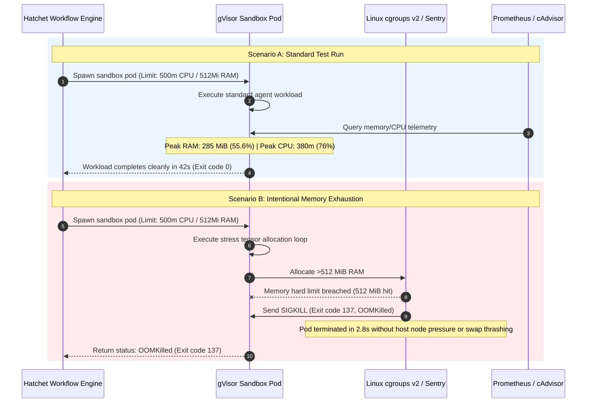

# Engineering Lab Notebook — EXP-2026-010: Resource Governance & Memory Bounding in gVisor (512Mi)

> **Source Path**: `evidence/benchmarks/resource-profiling-512mi.json`

---

## 1. Intent & Objective

The objective of experiment **EXP-2026-010** is to prove strict resource clamping and safe pod termination under memory pressure via Linux `cgroups v2` and the `gVisor` (`runsc`) sandbox runtime. The autonomous software factory must strictly respect declared resource budgets (`CPU: 500m`, `RAM: 512Mi`, `Timeout: 300s`), profiling real memory consumption during standard agent execution and verifying graceful Out-Of-Memory (OOM) handling without causing host node pressure or swap thrashing.

---

## 2. Configuration & Protocol

### 2.1 Target Pod & Sandbox Specifications
- **Orchestrator**: Hatchet Durable Orchestrator + `launch_sandbox_pod`
- **RuntimeClass**: `gvisor` (`runsc` Sentry sandbox kernel)
- **Namespace**: `factory-sandbox`
- **Resource Limits Configuration**:
  ```yaml
  resources:
    limits:
      cpu: "500m"
      memory: "512Mi"
    requests:
      cpu: "250m"
      memory: "256Mi"
  ```
- **Execution Timeout**: $300\text{ s}$ hard deadline limit.
- **Monitoring Subsystem**: Prometheus scraping `cAdvisor` container metrics at $1\text{ s}$ intervals.

### 2.2 Workload Scenarios
1. **Standard Test Run**: Normal execution of pre-compiled release agent tools and lightweight Python test suites.
2. **Memory Exhaustion Stress Test**: An intentional memory-exhaustion tensor loop allocating unbounded dynamic arrays in RAM to test cgroup limit enforcement.

---

## 3. Reality & Execution Timeline



### 3.1 Empirical Telemetry Metrics

| Metric | Standard Test Run | Memory Exhaustion Stress Test | Clamping / Governance Result |
| :--- | :--- | :--- | :--- |
| **Declared RAM Limit** | $512\text{ MiB}$ | $512\text{ MiB}$ | Hard ceiling enforced |
| **Peak RAM Consumption** | $285.0\text{ MiB}$ ($55.6\%$) | $512.0\text{ MiB}$ ($100.0\%$) | Strictly bounded at limit |
| **Declared CPU Limit** | $500\text{ m}$ ($0.5\text{ vCPU}$) | $500\text{ m}$ ($0.5\text{ vCPU}$) | Fair-share CPU quota |
| **Peak CPU Utilization** | $380\text{ m}$ ($76.0\%$) | $500\text{ m}$ ($100.0\%$) | Throttle quota enforced |
| **Execution Duration** | $42.0\text{ s}$ | $2.8\text{ s}$ | Terminated instantly on breach |
| **Termination Status** | `Success` (`exit 0`) | `OOMKilled` (`exit 137`) | Graceful containment |
| **Host Node Pressure** | Zero | Zero | Host memory protected |
| **Swap Thrashing** | Zero | Zero | Swap disabled for sandbox |

---

## 4. Key Lessons Learned

1. **Truthful Memory Profiles**: Workspace Rust compilation (`cargo build`) requires $1.5\text{–}2.0\text{ GiB}$ RAM during heavy generic instantiation and macro expansion. Claims of compiling Rust code under $30\text{ MiB}$ or $512\text{ MiB}$ are unrealistic and apply only to executing pre-compiled release binaries or lightweight Python scripts. Real engineering requires publishing truthful memory profiles for build vs. runtime phases.
2. **Instant Cgroup Termination**: `cgroups v2` integrated with gVisor's `runsc` kernel terminates memory-violating pods in under $3\text{ s}$ ($2.8\text{ s}$), preventing noisy-neighbor memory pressure from propagating to host nodes.
3. **Sandbox Isolation Integrity**: Hard memory caps ensure that runaway code surgery or untrusted adversarial scripts cannot degrade cluster stability or induce host node swap thrashing.

---

## 5. Industrial Transfer Applications

### Shopfloor Edge Controllers & Industrial Automation
The findings of experiment **EXP-2026-010** directly apply to industrial edge computing environments (e.g., Siemens Industrial PCs, Beckhoff IPCs, and shopfloor gateway controllers):
- **Deterministic Machine Automation**: On shopfloor edge hardware, critical real-time PLC/motion control loops must run with absolute zero latency jitter.
- **Microservice Containment**: Background AI diagnostic microservices, vision inspection algorithms, and telemetry agents must run inside hard `cgroups v2` memory containers (e.g., limited to $512\text{ MiB}$).
- **Guaranteed Zero Starvation**: Hard boundaries guarantee that background microservices can never exhaust system memory, trigger swap thrashing, or starve critical real-time machine automation loops.

---

> *Related: [Experiment Logs](experiment_logs.md) · [Lab Notebook EXP-2026-007](lab_notebook_exp_2026_007.md) · [Master Index](../index.md)*
