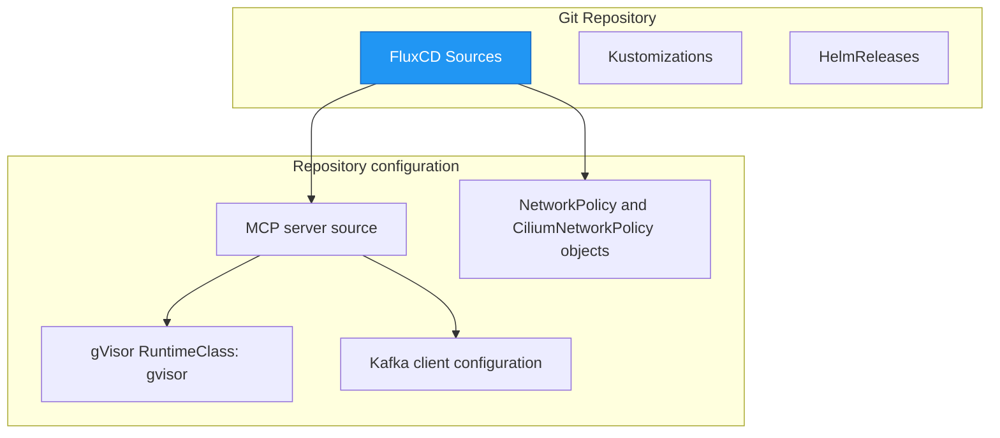

# Production Operations — Dark Gravity CA/CD Autonomous Factory

> **Purpose**: Checked-in configuration references, LiteLLM settings, and troubleshooting notes. This page does not establish a live cluster topology.

---

## 1. FluxCD GitOps Deployment Topology



---

## 2. Namespace references in checked-in manifests

The checked-in manifests reference `development` in admission-policy bindings, `factory-sandbox` for sandbox resources, and `openziti` in a namespace selector. They do not define a complete namespace inventory or establish that these namespaces exist in a running cluster. The full namespace list is **TO CONFIRM**.

The `RuntimeClass` is named `gvisor` and uses the `runsc` handler. Its fixed overhead is `35Mi` memory and `100m` CPU. The repository does not establish the active CNI or a live pod's resource usage.

---

## 3. LiteLLM Routing Configuration

The endpoint below is an example, not a deployment record. The MCP server source default uses the `llm-apps` service name; the active endpoint and namespace are **TO CONFIRM**.

```yaml
# LiteLLM config.yaml
model_list:
  - model_name: ollama/qwen2.5:7b
    litellm_params:
      model: ollama/qwen2.5:7b
      # Example only; live endpoint is TO CONFIRM.
      api_base: http://ollama.llm-apps:11434
  - model_name: gpt-oss-120b
    litellm_params:
      model: azure/gpt-oss-120b
      api_base: ${AZURE_OPENAI_ENDPOINT}
      api_key: ${AZURE_OPENAI_KEY}

general_settings:
  virtual_key_management: true  # FinOps virtual tags
```

---

## 4. Troubleshooting Runbook

### Pod Crash Loops

| Symptom | Cause | Resolution |
|:---|:---|:---|
| MCP server CrashLoopBackOff | Missing env vars | Check `LITELLM_API_BASE`, `HATCHET_API_URL` |
| Poller CrashLoopBackOff | GitHub token expired | Rotate `GITHUB_TOKEN` in sealed-secrets |
| Sandbox pod OOMKilled | Memory limit exceeded | Verify `SandboxConstraint.max_memory_mb <= 30` |

### Kafka Lag

| Symptom | Cause | Resolution |
|:---|:---|:---|
| Consumer lag > 1000 | Slow consumer | Scale consumer replicas |
| Topic not found | Topic not created | Run `kafka-topics --create` |

### Ziti Tunnel Drops

| Symptom | Cause | Resolution |
|:---|:---|:---|
| Connection refused on ziti endpoint | Tunnel pod restart | Check `ziti-tunnel` sidecar logs |
| Certificate expired | PKI rotation needed | Renew OpenZiti identity |

### Hatchet DAG Failures

| Symptom | Cause | Resolution |
|:---|:---|:---|
| Phase 2 timeout | LLM model too slow | Switch to faster model via `LITELLM_PLANNER_MODEL` |
| Phase 3 circuit breaker | Stagnant diff hash | HITL Vertex 3 override required |
| Phase 4 SAST gate fail | Score < 8.0 | Review generated code for security issues |

---

> *Related: [User Manual](user_manual.md) · [Experiment Lifecycle](../architecture/runtime_sequences.md)*